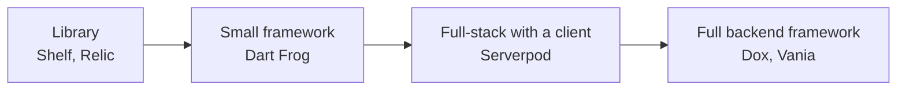

# Dart backend frameworks: how to choose

This post compares five Dart backend options, Serverpod, Dart Frog, Shelf, Vania and Dox, by what each one includes, so you can pick the one that fits your app.

<!-- more -->

You know Dart, maybe from Flutter, and now you need a server.
The articles we found compare only three options, and they rarely check what a real backend needs: a database, migrations, background jobs and mail.
This post does.

We build Dox, so we are not neutral.
That is why every fact about another project links to its own docs, GitHub or pub.dev page.

!!! tip "In brief"
    Pick by what your app needs.

    - You want a typed client made for your Flutter app: **Serverpod**.
    - You want a small API with few parts: **Dart Frog** or **Shelf**.
    - You want routes, an ORM, migrations, queues, mail and auth in one framework: **Dox** or **Vania**.

## The short answer

- **[Serverpod](https://serverpod.dev)**: pick it if your client is a Flutter app and you want the client code made for you.
  It also has a hosted service, Serverpod Cloud.
- **[Dart Frog](https://dart-frog.dev)**: pick it if you want a small, simple framework with routes from files.
- **[Shelf](https://pub.dev/packages/shelf)**: pick it if you want to build your own stack from small parts.
- **[Vania](https://vdart.dev)**: pick it if you want a full framework and you use MongoDB or MySQL.
- **[Dox](/latest/)**: pick it if you want a full framework with typed input, queues, mail and a scheduler, on Postgres, MySQL, MariaDB or SQLite.

## Four kinds of Dart backend

The options are not all the same kind of thing.
You can put them on one line, from "you pick every part" to "most parts come with it":



1. **A library** is the base layer. It gives you the request, the response and middleware. You add the router, the database and the rest.
2. **A small framework** is a library plus routing, a CLI and a dev server. You still add the database and other parts.
3. **A full-stack framework with a client** is built for one kind of client. It makes the server and the client code from one place.
4. **A full backend framework** is the largest kind. It includes the database layer, migrations, auth, mail and more. It does not care which client calls it.

None of these is better in general.
A library is the right choice when you want control.
However, a full framework saves time when you do not want to pick and connect many packages, such as a driver, a migration tool, a queue and a mailer.

## What is built in

This table lists what each project ships, by its own docs.
"Not built in" means you add a package or write it yourself.
It does not mean you can not do it.

| Feature | Dox | Serverpod | Dart Frog | Shelf | Vania |
| --- | --- | --- | --- | --- | --- |
| Routing | `Route.get(...)`, groups, resources | Endpoint methods. A separate web server (Relic) has routes. | Routes from files in `routes/` | `shelf_router` | `Router.get(...)`, groups, resources |
| Typed input checks | `@Dto` classes, `422` on bad input | Typed, generated endpoint parameters | Not built in | Not built in | Rules in strings, fluent rules, form classes |
| ORM and relations | Yes | Yes | Not built in | Not built in | Yes |
| Migrations | Yes | Yes | Not built in | Not built in | Yes |
| Auth | JWT, sessions, access tokens | Email, Google, Apple, passkeys and more | `dart_frog_auth` (Basic, Bearer, Cookie) | Not built in | `vania_auth`: JWT, guards, access tokens |
| Background jobs | Queue (database, Redis) | Future calls, stored in the database | Not built in | Not built in | Not in their docs |
| Scheduled tasks | Scheduler | Recurring future calls (interval or cron) | Not built in | Not built in | Not in their docs |
| Mail | SMTP, SES, Resend, Mailgun and more | Only sign-in emails, through Serverpod Cloud. Otherwise your own provider. | Not built in | Not built in | SMTP |
| Cache | Memory, file, Redis, database | Local and Redis caches | Not built in | Not built in | File, Redis with `vania_redis` |
| File storage | Local, S3 and S3-compatible | Database, Google Cloud Storage, S3, R2 | Not built in | Not built in | Local, S3 |
| WebSocket | Socket.IO server, raw WebSocket | Streaming methods | `dart_frog_web_socket` | `shelf_web_socket` | Built in. Rooms with `vania_websocket`. |
| OpenAPI | Made from routes and DTOs | Not built in (third-party packages exist) | Not built in | Not built in | `vania_swagger` |
| CLI | `dox` | `serverpod` | `dart_frog` | No CLI | `vania` (from `vania_cli`) |
| Databases | Postgres, MySQL, MariaDB, SQLite | Postgres, SQLite | Not built in | Not built in | MySQL, MariaDB, Postgres, MongoDB |
| License | MIT | BSD-3 for most packages. The main `serverpod` package is SSPL. | MIT | BSD-3-Clause | MIT |
| On pub.dev since | 2023 (3.0 in October 2026) | 2021 | 2022 | 2014 | 2024 |


Facts checked on 2026-11-17.
We analyzed the docs, READMEs and pub.dev pages of each project on 2026-11-17, and we read the source of `vania` 2.1.0 from pub.dev.
If you find a wrong fact, contact us with a [GitHub issue](https://github.com/dartondox/dox/issues), and we will fix it.
Latest versions on that day: `serverpod` 4.1.2, `relic` 2.0.0, `dart_frog` 1.2.6, `shelf` 1.4.3, `vania` 2.1.0, `dox_core` 3.2.2.

Sources: [Serverpod docs](https://docs.serverpod.dev), [Dart Frog docs](https://dart-frog.dev), [Shelf on pub.dev](https://pub.dev/packages/shelf), [Vania docs](https://vdart.dev/docs/intro), [Vania on GitHub](https://github.com/vania-dart/framework).
The docs page [Dox and the other Dart backends](/latest/concepts/dart-frameworks/) has the full table, with more rows and a source link for each project.

## Serverpod

**[Serverpod](https://docs.serverpod.dev)** is a full-stack framework for Flutter.
You write endpoint methods on the server.
Serverpod then [generates a typed Dart client](https://docs.serverpod.dev/concepts/endpoints-and-apis), and your Flutter app calls the server like a local function.

What it is good at:

- **The generated client.** You do not write HTTP calls or JSON parsing by hand for your endpoints.
- **Many years of use.** It has been on [pub.dev](https://pub.dev/packages/serverpod) since 2021.
- **A hosted service.** [Serverpod Cloud](https://docs.serverpod.dev/cloud) deploys your server and its database for you.
- **A lot built in**: an ORM with migrations, many login providers, [caching](https://docs.serverpod.dev/concepts/endpoints-and-apis/caching), [file uploads](https://docs.serverpod.dev/concepts/endpoints-and-apis/file-uploads) and [future calls](https://docs.serverpod.dev/concepts/scheduling/overview) for work that runs later.

When it may not fit:

- Your database is MySQL or MongoDB. Serverpod uses Postgres and SQLite.
  In contrast, Dox and Vania support MySQL, and Vania supports MongoDB.
- Many of your clients are not Flutter apps. The generated client is Dart.
- The license matters to you. The main `serverpod` package uses the [SSPL](https://github.com/serverpod/serverpod/blob/main/packages/serverpod/LICENSE). Most other packages use BSD-3.

## Dart Frog

**[Dart Frog](https://dart-frog.dev)** is a small backend framework built on Shelf.
Each file in the `routes/` folder is a route.
The `dart_frog` CLI makes a project, runs a dev server with hot reload, and makes a production build.

What it is good at:

- **It is simple.** There are few concepts to learn.
- **File-based routes.** The folder tree shows your whole API.
- **Small add-on packages** for auth and WebSocket.

Things to know:

- There is no database layer. For example, you pick your own Postgres driver and write your own migrations.
- The project moved to the `dart-frog-dev` group in 2025. See [the post by Very Good Ventures](https://www.verygood.ventures/blog/dart-frog-has-found-a-new-pond).
- The last `dart_frog` release on [pub.dev](https://pub.dev/packages/dart_frog) is 1.2.6, from November 2025.

## Shelf (and Relic)

**[Shelf](https://pub.dev/packages/shelf)** is the request and middleware model from the [Dart team](https://dart.dev/server).
It is a library, not a framework.
You add [`shelf_router`](https://pub.dev/packages/shelf_router) for routes, and then you pick every other part yourself.

Shelf is a good choice when you want full control, or when you build a small service with one job.
Dart Frog is built on it.

**[Relic](https://pub.dev/packages/relic)** is a newer web server from the Serverpod team.
Its README says it is "inspired by Shelf", with typed headers, its own router and WebSocket support.
Serverpod's own [web server](https://docs.serverpod.dev/concepts/web-server/overview) is built on it.
Like Shelf, it is not a full framework.

## Vania

**[Vania](https://vdart.dev)** is a full backend framework.
Its README calls it "a batteries-included backend framework for Dart".

What is in the core package: routing, middleware, validation, an ORM with relations, migrations, seeders, sessions, a cache, mail, file storage and an IoC container.
Auth, OpenAPI, Redis and WebSocket rooms come as [add-on packages](https://vdart.dev/docs/packages/auth).

What it is good at:

- **MongoDB.** It has drivers for MySQL, MariaDB, Postgres and MongoDB, behind one database API.
- **A full CLI.** `vania create`, `vania serve` with hot reload, `make:*` commands, migrations and `vania build`.
- **Recent releases.** Version 2.1.0 came out in October 2026.

Things to know:

- A queue and a scheduler are not in [their docs](https://vdart.dev/docs/intro).
- Validation rules are written as strings or fluent rules, not as typed fields on a class. See [their validation page](https://vdart.dev/docs/core/validation).
- There is no SQLite driver package in their docs.

## Dox

**Dox** is a full backend framework, and the one we build.
`dox create` makes a project with routes, the ORM, migrations, a queue, a scheduler, a cache and file storage.
`dox add` adds more packages, like mail, auth and Socket.IO.

The part we like most is typed input.
You write a `@Dto` class, and your controller gets a checked, typed object:

```dart title="lib/app/dtos/save_task/save_task.dto.dart"
import 'package:dox_core/dox_core.dart';

part 'save_task.dto.g.dart';

@Dto()
class SaveTask {
  @Trim()
  @Length(min: 3, max: 100)
  final String title;

  final int projectId;

  const SaveTask({required this.title, required this.projectId});

  static const DtoSchema<SaveTask> schema = $SaveTaskDto;
}
```

```dart title="lib/app/http/controllers/task.controller.dart"
@Inject()
class TaskController {
  Future<DoxResponse> store(SaveTask body) async {
    Task task = Task()
      ..title = body.title
      ..projectId = body.projectId;
    await task.save();
    return response(task).statusCode(201);
  }
}
```

```dart title="lib/routes/api.dart"
Route.post('/tasks', (TaskController c) => c.store);
```

When `title` is too short or `project_id` is missing, the client gets a `422` with the errors, and `store` does not run.
`Task` is a model, made with `dox make:model Task -m`.
The same DTO also feeds the [OpenAPI docs](/latest/packages/openapi/), and you can share it with a Flutter app.

What it is good at:

- **Many parts in one place**: ORM, migrations, auth, [queue](/latest/digging-deeper/queue/), mail, scheduler, cache and storage.
- **Four SQL databases**: Postgres, MySQL, MariaDB and SQLite. A new project uses SQLite, so you install nothing to start.
- **Any client.** It is a plain HTTP API with OpenAPI docs, so web, mobile and other servers can call it.
- **One binary.** `dox build` makes a native binary for your server.

### When not to pick Dox

- **You want a long track record.** Dox has been on pub.dev since 2023, but version 3 came out in October 2026. Serverpod, Dart Frog and Shelf have more years of real use.
- **You want the Dart client made for you.** Dox does not generate a Dart client. It makes an OpenAPI document, and you can share DTO classes with Flutter.
- **You want a hosted service.** Dox has none. You deploy it yourself, with a binary or [Docker](/latest/guides/docker/).
- **You use MongoDB.** Dox supports SQL databases only.
- **You want very few parts.** Dart Frog or Shelf are smaller.

More gaps are listed on [What Dox does not have yet](/latest/concepts/status-and-roadmap/#what-dox-does-not-have-yet).

## How to choose: five questions

1. **Do you want a client made for your Flutter app?**
   Yes: start with Serverpod.
2. **Do you need a database with migrations?**
   Yes: look at Dox, Serverpod or Vania. Dart Frog and Shelf need a separate package.
3. **Do you need background jobs, mail or scheduled tasks?**
   Dox has all three. Serverpod has future calls for jobs and schedules. Vania has mail.
4. **Which database do you use?**
   Postgres: Dox, Serverpod or Vania. SQLite: Dox or Serverpod. MySQL or MariaDB: Dox or Vania. MongoDB: Vania.
5. **Do you want a long track record, or are you fine with a newer project?**
   Long track record: Shelf, Serverpod or Dart Frog. Newer is fine: Dox and Vania are options too.

## FAQ

### Is Dart good for backend development?

Yes, for a team that already knows Dart.
You use one language on the server and in the Flutter app, and you can share code between them.
The server ecosystem is smaller than the one for Node.js or Go, so some packages you may want do not exist yet.

### Can I share models between Flutter and the server?

Yes, with all five.
You put the classes in a plain Dart package that both apps use.
Serverpod generates this package for you.
In Dox, you put `@Dto` classes in a shared package, so the app and the server check input with the same rules.
See [Share code with Flutter](/latest/guides/share-code-with-flutter/).

### Does Dox replace Serverpod?

No. They have different goals.
Serverpod is built around a Flutter client.
Dox is a general backend for any client.
If the generated client is what you want most, Serverpod is the better fit.

## Summary

- Pick a library (Shelf) or a small framework (Dart Frog) when you want control and few parts.
- Pick Serverpod when your client is Flutter and you want the client made for you.
- Pick a full backend framework (Dox or Vania) when you want the database, jobs, mail and auth in one place.

Want to try Dox?
The [tutorial](/latest/tutorial/) builds a small API with a database, validation, login and tests.
For a shorter path, read [Build a Dart API with Dox](build-a-dart-api-with-dox.md) or [A tour of Dox features](dox-feature-tour.md).
