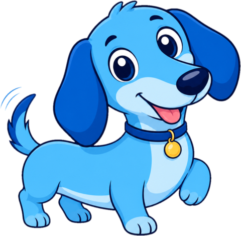

# Meet Doxie

{ width="260" }

Doxie is the official mascot of Dox. Doxie is a blue dachshund.

## Why a dachshund

"Doxie" is a common nickname for a dachshund. It sounds like Dox, so the name came first.

A dachshund is small, fast and full of energy. Dox tries to be the same: a small native binary that serves a lot of requests.

## Logo and mascot

Dox has a logo and a mascot, with different jobs:

| | Logo | Mascot |
| --- | --- | --- |
| What | A hexagon with a "D" cut out | Doxie, the blue dachshund |
| Where | The docs header, the favicon, the README, pub.dev | The home page, social cards, talks, stickers |
| Files | [`logo.svg`](../assets/logo.svg) (white, for dark backgrounds) | [`mascot.png`](../assets/mascot.png) (transparent background) |

Use the logo in a small space, like an icon or an avatar. Doxie has too much detail for 16 or 32 pixels.

## Colors

| Name | Hex | Used for |
| --- | --- | --- |
| Sky blue | `#5CC6FF` | Doxie's body, links in dark mode |
| Dart blue | `#0A5FC2` | Doxie's ears and collar, links in light mode |
| Navy | `#0B1B36` | The docs header, outlines |

## Use Doxie

You can use Doxie when you write or talk about Dox: blog posts, slides, videos and stickers. Do not change the colors of Doxie, and do not use Doxie for another product.

## Next steps

- [Showcase](showcase.md): apps built with Dox.
- [Contribute](contribute.md): work on Dox.
