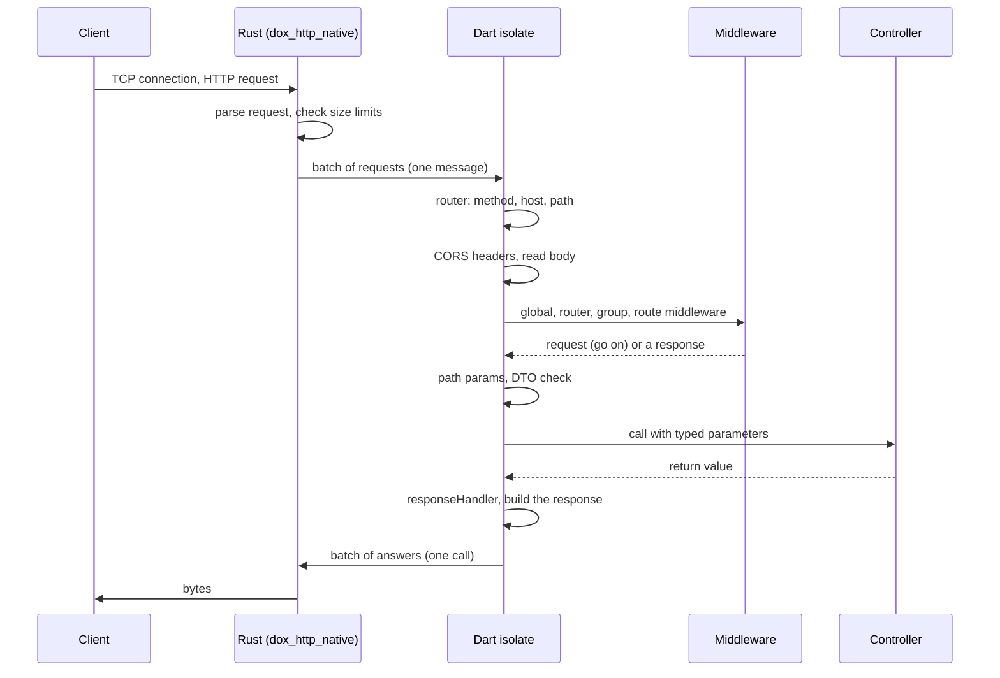

# How Dox works

This page explains what happens inside Dox when a request comes in, how isolates work and what each folder of an app is for.

## The life of a request

Dox has two parts:

- A native server, written in Rust (`dox_http_native`). It owns the sockets and parses HTTP.
- Your app, written in Dart. Routes, middleware, DTOs, controllers and the ORM all run here.

A request goes through these steps:

1. Rust accepts the connection and reads the request. It parses the HTTP request line, the headers and the body.
   A bad request gets `400`. Headers over 16 KB get `431`. A body over the size limit gets `413`. Dart never sees these requests.
2. Rust hands the requests to Dart in a batch. One message holds many requests.
3. Dart finds the route. It matches the method, the `Host` (for domain routes) and the path.
   A plain path is a map lookup. A path with `{params}` is a pattern match.
   No match gives `404`. A CORS preflight (`OPTIONS`) gets `204`.
4. Dart adds the CORS headers of the route.
5. Dart reads the body, only when the request has a `Content-Type`. A request without a body skips this step.
6. Dart runs the middleware list of the route, in this order: global middleware, router middleware, group middleware, route middleware.
   A middleware returns the request to go on. Anything else is sent as the response, and the controller does not run.
7. Dart fills the controller parameters. Path params are converted first. A value that does not fit its type (`abc` for `int id`) gets `404`.
   Then the DTO is read and checked. Bad input gets `422`. A body that is not JSON gets `400`. A content type Dox can not read gets `415`.
8. The controller runs and returns a value.
9. The `responseHandler` from `AppConfig` runs, when you set one. It can change every response.
10. Dox turns the value into the response: a `String` is text, a `Map` or model is JSON, a `File` is streamed.
11. Dart sends the answers of the batch back to Rust in one call. Rust writes the bytes to the socket.

When a step throws, Dox catches the error. An `IHttpException` (like `NotFoundHttpException`) gives its own status.
Any other error gives `500` and goes to the `report` method of the `ExceptionHandler` in `AppConfig`.



!!! note "No reflection"
    Dox reads the parameter types of every controller once, at start.
    It does not use `dart:mirrors`. DTOs come from a generated list (`lib/generated/dtos.g.dart`).
    This is why `dox build` can make a native (AOT) binary.

### Where things are decided

| Step | Code | What it decides |
| --- | --- | --- |
| Route match | `lib/routes/*.dart`, `Route.get(...)` | which controller runs |
| Middleware | `AppConfig(globalMiddleware:)`, `Router.middleware`, `Route.middleware(...)`, the route list | go on, or answer early |
| Input | a `@Dto` class in `lib/app/dtos/<name>/` | what the controller gets, or `422` |
| Output | the return value, `response(...)`, `responseHandler` | status, headers, body |
| Errors | `IHttpException`, `AppConfig(exceptionHandler:)` | the error response, logging |

See [Routing](../the-basic/routing.md), [Middleware](../the-basic/middleware.md),
[Validation](../the-basic/validation.md) and [Response](../the-basic/response.md).

## Isolates

Dart runs code on isolates. An isolate is like a thread, but it has its own memory.
Dox starts one isolate per CPU core (`Platform.numberOfProcessors`). Every isolate runs the full app.

### One port, many isolates

Every isolate runs its own HTTP server on the same port. The operating system spreads the connections.

| System | Native server |
| --- | --- |
| Linux | one socket per isolate (`SO_REUSEPORT`) |
| macOS | the isolates share one socket |
| Windows | only one isolate serves HTTP |

Each isolate does its own socket work on its own thread. See [Native server](../digging-deeper/native-server.md#how-it-works).

### What each isolate gets

Before it starts an isolate, Dox copies three things to it:

- the `AppConfig`,
- the list of providers,
- the routes and route binders (`Route.bind`) you added before `startServer()`.

Then each isolate does this, once:

1. It runs `setup()` of every provider, in list order. This is where a database pool is opened.
2. It registers the routes of your routers.
3. It reads the parameter types of every controller.
4. It starts its HTTP server.

Nothing in this list runs per request.

Because the config and the providers are copied, they must not hold open sockets or pools.
Open these in `setup()`. See [Providers](../digging-deeper/providers.md).

### Each isolate has its own memory

- A static value or a singleton exists once per isolate. A change in one isolate is not seen in the others.
- The `memory` cache store is per isolate. Use the `redis` store to share cache data.
- To share data between isolates, use the database, Redis or files.
- `Dox().isolateId` tells you which isolate runs the code. The first one is `1`.

### When an isolate crashes

- An error in a request is caught. Dox answers `500` and keeps going.
- An async error outside a request is caught and passed to the `ExceptionHandler`. The isolate keeps running.
- When a worker isolate still dies, Dox prints `[dox] isolate N exited, restarting` and starts a new one after 1 second.
- When the first (main) isolate dies, the process exits with a non-zero code. A supervisor (Docker `restart:`, systemd `Restart=always`) must start it again.

### How many isolates

Set `totalIsolate` in `AppConfig`, or `APP_TOTAL_ISOLATE` in `.env`. In code, `Dox().totalIsolate(2)` before `startServer()` wins over the config.
Use `1` in tests. See [Isolate](../digging-deeper/isolate.md).

## Where the database pools live

The ORM is started in a provider (`ORMProvider`). Every isolate runs `setup()`, so every isolate opens a pool.
The native drivers live in Rust. There, isolates that open the same settings get the same pool.

| Driver | Per isolate | Per process |
| --- | --- | --- |
| Postgres native (`dox_postgres_native`) | nothing | one pool of `maxConnectionCount` connections per settings, and one Rust runtime (`extra['threads']`, default `1`) |
| MySQL native (`dox_mysql_native`) | nothing | one pool of `maxConnectionCount` connections per settings, and one Rust runtime |
| SQLite | one connection | nothing shared |

So for Postgres and MySQL, the app opens at most `maxConnectionCount` connections, for any number of isolates.
The pool size is always your choice. Set it below the `max_connections` of the database.

The pool closes when the last isolate that uses it closes it.
See [Native Postgres driver](../database/postgres-native.md#options).

Postgres and MySQL have only the native drivers. When the native library does not load, the app stops with an error that says why and how to fix it. See [Database](../database/index.md).

## The layout of a Dox app

`dox create my_app` copies the [dox-sample](https://github.com/dartondox/dox-sample) template. It looks like this:

```text
my_app/
├── bin/
│   ├── server.dart          # starts the app
│   ├── migrate.dart         # runs the migrations (dox migration:*)
│   ├── seed.dart            # runs the seeders (dox db:seed)
│   ├── queue.dart           # the queue worker (dox queue:*)
│   └── schedule.dart        # the scheduler (dox schedule:*)
├── db/
│   ├── factories/           # model factories, *.factory.dart
│   ├── migration/           # migrations (.dart with a registry, or .sql)
│   └── seeders/             # seeders, *.seeder.dart
├── lib/
│   ├── app/
│   │   ├── http/
│   │   │   └── controllers/     # *.controller.dart
│   │   ├── jobs/                # queue jobs, *.job.dart
│   │   └── models/              # one folder per model, *.model.dart
│   ├── config/
│   │   ├── app.dart             # AppConfig: port, isolates, middleware
│   │   ├── cache.dart           # cache stores
│   │   ├── cors.dart
│   │   ├── database.dart        # DatabaseConfig: connections
│   │   ├── env.dart             # typed env class (@DoxEnv)
│   │   ├── logger.dart
│   │   ├── queue.dart           # QueueConfig
│   │   ├── schedule.dart        # ScheduleConfig and your tasks
│   │   └── storage.dart         # storage disks
│   ├── routes/
│   │   ├── api.dart             # ApiRouter, prefix `api`
│   │   └── web.dart             # WebRouter
│   ├── providers/               # one DoxProvider per file, runs in every isolate
│   │   ├── orm_provider.dart        # opens the database
│   │   ├── queue_provider.dart
│   │   ├── schedule_provider.dart
│   │   └── storage_provider.dart
│   └── generated/               # made by build_runner, do not edit
│       ├── container.g.dart     # @Inject classes, routers, providers
│       ├── jobs.g.dart          # the list of queue jobs
│       └── openapi.g.dart       # the OpenAPI docs
├── test/
├── .env                         # local settings, not in git. `dox create` makes it
├── .env.example
├── Dockerfile
├── docker-compose.yml
└── pubspec.yaml
```

The `dox make:*` commands add more folders when you need them:

- `dox make:dto` adds `lib/app/dtos/<name>/<name>.dto.dart`. Then `build_runner` writes `lib/generated/dtos.g.dart`, the list of DTOs.
- `dox make:middleware` adds `lib/app/http/middleware/`.
- `dox make:serializer` adds `lib/app/http/serializers/`.

The app makes `storage/` when it writes files (the local disk, the file cache, uploads).

| Folder | What goes there |
| --- | --- |
| `bin/` | `server.dart` calls `Dox().initialize(appConfig)`, runs the migrations, then `Dox().startServer()`. The other files are the entry points that the `dox migration:*`, `db:seed`, `queue:*` and `schedule:*` commands run. |
| `db/` | Your migrations, factories and seeders. Dart migrations are listed in `db/migration/migrations.dart`, which the CLI writes. |
| `lib/app/http/` | Everything about HTTP: controllers, middleware, serializers. |
| `lib/app/dtos/` | One folder per DTO: typed and checked input. |
| `lib/app/jobs/` | Queue jobs. |
| `lib/app/models/` | One folder per model. `build_runner` writes the `.g.dart` file next to it. |
| `lib/config/` | One file per config object. `app.dart` puts them together in `AppConfig`. |
| `lib/routes/` | One `Router` class per file. Dox finds each router by itself. |
| `lib/providers/` | Classes that extend `DoxProvider`. Their `setup()` runs in every isolate. Dox finds each provider by itself. |
| `lib/generated/` | Generated files. Do not edit them. Run `dox build_runner:build` to make them again. |
| `storage/` | Files the app writes: uploads, the file cache, SQLite files. |

`build_runner` with `dox_builder` makes the model classes, the DTO checks, the typed env class and the OpenAPI docs.
