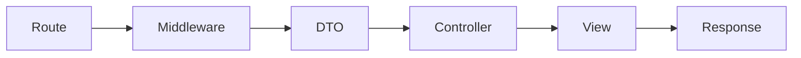
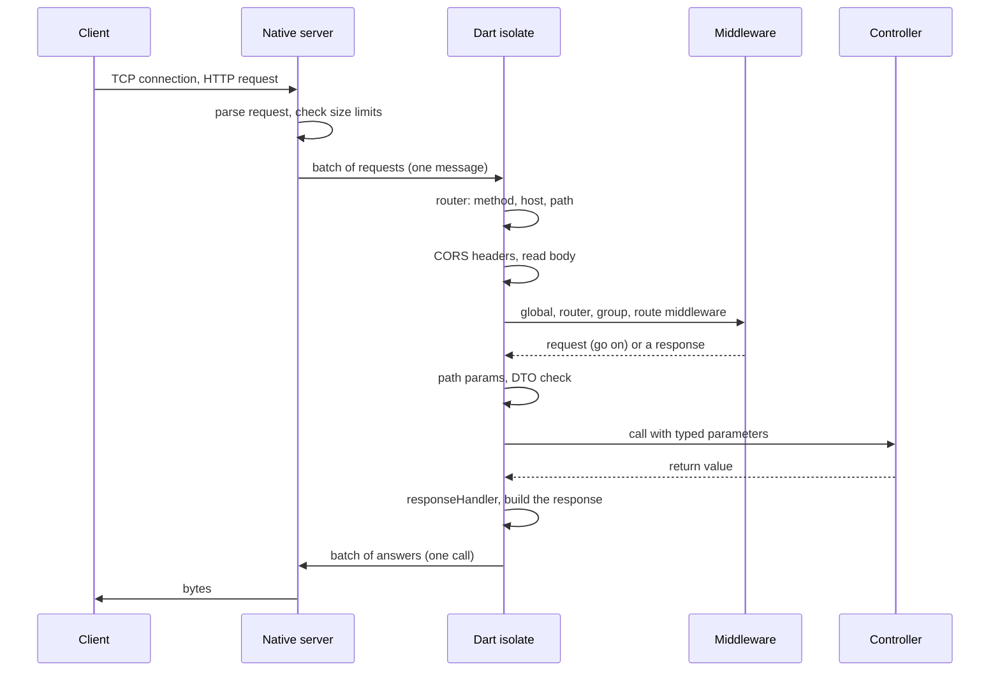

# How Dox works

This page shows the path of a request, how isolates work and what each folder of an app is for.

## The life of a request

Each request takes the same path. The pages in "The basics" follow this order:



[Routing](../the-basic/routing.md) → [Middleware](../the-basic/middleware.md) → [DTOs](../the-basic/dto.md) → [Controller](../the-basic/controller.md) → [Views](../the-basic/views.md) → [Response](../the-basic/response.md)

Dox has two parts. The native server (`dox_http_native`) owns the sockets and parses HTTP. Your Dart app runs the routes, middleware, DTOs, controllers and the ORM.

A request goes through these steps:

1. The native server parses the request. A broken request gets 400, headers over 16 KB get 431, and a body over the size limit gets 413.
2. The native server gives the requests to Dart in a batch.
3. Dart finds the route by the method, the host and the path. No match gets 404. A CORS preflight gets 204.
4. Dart adds the CORS headers of the route.
5. Dart reads the body, if the request has a content type.
6. Dart runs the middleware in this order: global, router, group, route. If a middleware returns a value that is not the request, Dart sends that value as the response.
7. Dart fills the controller parameters. A path param that does not fit its type gets 404. Bad DTO input gets 422, a body that is not JSON gets 400, and an unknown content type gets 415.
8. The controller runs and returns a value.
9. The `responseHandler` of `AppConfig` runs, if you set one.
10. Dox makes the response: a string is text, a map or model is JSON, and a file is streamed.
11. Dart gives the answers of the batch back to the native server, which writes them to the socket.

If a step throws, Dox catches the error. An `IHttpException` gives its own status. Any other error gives 500 and goes to the `report` method of your `ExceptionHandler`.



Dox uses no reflection. DTOs come from a generated list, so `dox build` can make a native binary.

### Where things are decided

| Step | Code | What it decides |
| --- | --- | --- |
| Route match | `lib/routes/*.dart`, `Route.get(...)` | which controller runs |
| Middleware | `AppConfig(globalMiddleware:)`, `Router.middleware`, `Route.middleware(...)`, the route list | go on, or answer early |
| Input | a `@Dto` class in `lib/app/dtos/<name>/` | what the controller gets, or 422 |
| Output | the return value, `response(...)`, `responseHandler` | status, headers, body |
| Errors | `IHttpException`, `AppConfig(exceptionHandler:)` | the error response, logging |

## Isolates

An **isolate** is like a thread with its own memory. Dox starts one isolate for each CPU that the process can use, also in a container, and each isolate runs the full app.

### One port, many isolates

Each isolate runs its own HTTP server on the same port:

| System | Native server |
| --- | --- |
| Linux | one socket per isolate (`SO_REUSEPORT`) |
| macOS | the isolates share one socket |
| Windows | only one isolate serves HTTP |

See [Native server](../digging-deeper/native-server.md#how-it-works).

### What each isolate gets

Dox copies the `AppConfig`, the providers, and the routes and binders that you added before `startServer()` to each isolate. Then each isolate does these steps one time:

1. It runs `setup()` of each provider, in list order.
2. It registers the routes of your routers.
3. It reads the parameter types of each controller.
4. It starts its HTTP server.

The config and the providers are copied, so they must not hold open sockets or pools. Open them in `setup()`. See [Providers](../digging-deeper/providers.md).

### Each isolate has its own memory

Isolates do not share memory:

- A static value or a singleton exists one time in each isolate.
- The memory cache store is per isolate. Use the Redis store to share cache data.
- To share data, use the database, Redis or files.

`Dox().isolateId` gives the isolate that runs the code. The first one is 1.

### When an isolate crashes

- An error in a request gets 500, and the isolate continues.
- An async error outside a request goes to the `ExceptionHandler`, and the isolate continues.
- If a worker isolate stops, Dox starts a new one after 1 second.
- If the main isolate stops, the process exits with an error code. In production, use a supervisor to start it again, like Docker `restart:` or systemd `Restart=always`.

### How many isolates

Set `totalIsolate` in `AppConfig` or `APP_TOTAL_ISOLATE` in `.env`. `Dox().totalIsolate(2)` before `startServer()` wins over the config. See [Isolate](../digging-deeper/isolate.md).

## Where the database pools live

Each isolate runs `setup()` of the ORM provider, so each isolate asks for a pool. The native drivers give isolates with the same settings the same pool:

| Driver | Per isolate | Per process |
| --- | --- | --- |
| Postgres native (`dox_postgres_native`) | nothing | one pool of `maxConnectionCount` connections per settings |
| MySQL native (`dox_mysql_native`) | nothing | one pool of `maxConnectionCount` connections per settings |
| SQLite | one connection | nothing shared |

So for Postgres and MySQL, the app opens at most `maxConnectionCount` connections for all isolates. Set it below the max_connections of the database. See [Native Postgres driver](../database/postgres-native.md#options).

## The layout of a Dox app

`dox create my_app` copies the [dox-sample](https://github.com/dartondox/dox-sample) template:

```text
my_app/
├── bin/
│   ├── server.dart          # starts the app
│   ├── migrate.dart         # runs the migrations (dox migration:*)
│   ├── seed.dart            # runs the seeders (dox db:seed)
│   ├── queue.dart           # the queue worker (dox queue:*)
│   └── schedule.dart        # the scheduler (dox schedule:*)
├── db/
│   ├── factories/           # model factories, *.factory.dart
│   ├── migration/           # migrations (.dart with a registry, or .sql)
│   └── seeders/             # seeders, *.seeder.dart
├── lib/
│   ├── app/
│   │   ├── http/
│   │   │   └── controllers/     # *.controller.dart
│   │   ├── jobs/                # queue jobs, *.job.dart
│   │   └── models/              # one folder per model, *.model.dart
│   ├── config/
│   │   ├── app.dart             # AppConfig: port, isolates, middleware
│   │   ├── cache.dart           # cache stores
│   │   ├── cors.dart
│   │   ├── database.dart        # DatabaseConfig: connections
│   │   ├── env.dart             # typed env class (@DoxEnv)
│   │   ├── logger.dart
│   │   ├── queue.dart           # QueueConfig
│   │   ├── schedule.dart        # ScheduleConfig and your tasks
│   │   └── storage.dart         # storage disks
│   ├── routes/
│   │   ├── api.dart             # ApiRouter, prefix `api`
│   │   └── web.dart             # WebRouter
│   ├── providers/               # one DoxProvider per file
│   │   ├── orm_provider.dart        # opens the database
│   │   ├── queue_provider.dart
│   │   ├── schedule_provider.dart
│   │   └── storage_provider.dart
│   └── generated/               # made by build_runner, do not edit
│       ├── container.g.dart     # @Inject classes, routers, providers
│       ├── jobs.g.dart          # the list of queue jobs
│       └── openapi.g.dart       # the OpenAPI docs
├── test/
├── .env                         # local settings, not in git
├── .env.example
├── Dockerfile
├── docker-compose.yml
└── pubspec.yaml
```

The `dox make:*` commands add more folders when you need them, like `lib/app/dtos/`, `lib/app/http/middleware/` and `lib/app/serializers/`. The app makes `storage/` when it first writes files.

| Folder | What goes there |
| --- | --- |
| `bin/` | `server.dart` calls `Dox().initialize(appConfig)`, runs the migrations, then `Dox().startServer()`. The other files are the entry points of the `dox migration:*`, `db:seed`, `queue:*` and `schedule:*` commands. |
| `db/` | Your migrations, factories and seeders. The CLI writes the list of Dart migrations in `db/migration/migrations.dart`. |
| `lib/app/http/` | Controllers and middleware. |
| `lib/app/serializers/` | Serializers. MCP and WebSocket code also use them. |
| `lib/app/dtos/` | One folder per DTO: typed and checked input. |
| `lib/app/jobs/` | Queue jobs. |
| `lib/app/models/` | One folder per model, with its generated file. |
| `lib/config/` | One file per config object. `app.dart` puts them together in `AppConfig`. |
| `lib/routes/` | One `Router` class per file. Dox finds each router. |
| `lib/providers/` | Classes that extend `DoxProvider`. Their `setup()` runs in each isolate. Dox finds each provider. |
| `lib/generated/` | Generated files. Run `dox build_runner:build` to make them again. |
| `storage/` | Files the app writes: uploads, the file cache, SQLite files. |

## Next steps

- [Isolate](../digging-deeper/isolate.md): more on isolates.
- [Providers](../digging-deeper/providers.md): code that runs when the app starts.
- [Build a blog API](../tutorial/index.md): build a full app.
