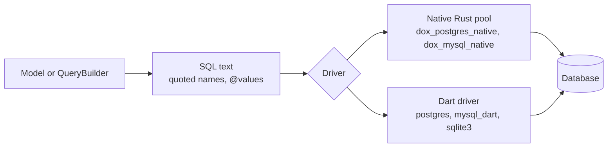
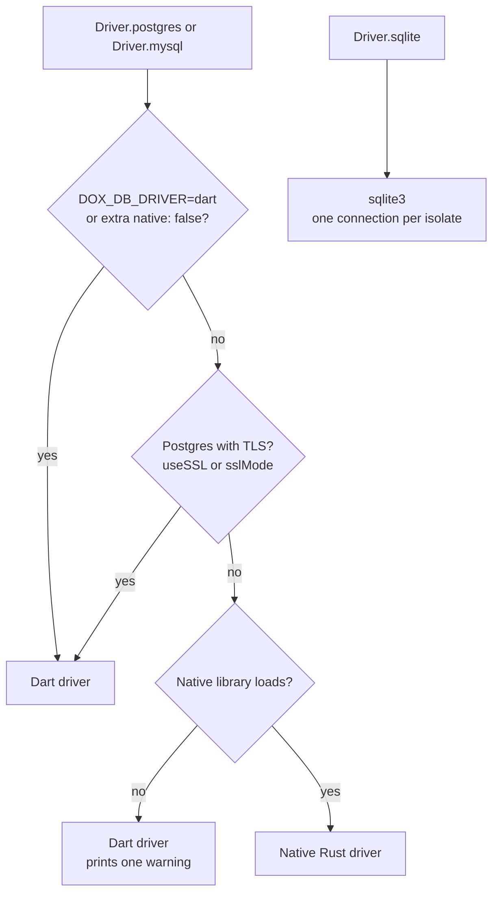

# Database

This page shows how to connect Dox to a database.
Dox works with Postgres, MySQL, MariaDB and SQLite through the `dox_orm` package.

- [Query builder](query-builder.md): build SQL with methods.
- [Models](model/index.md): one class per table.
- [Transactions](transactions.md): many queries that succeed or fail together.
- [Migration](migration.md) and [Schema](schema.md): create and change tables.

This is how a query travels from your code to the database:



## Install

The query builder and the models are in the `dox_orm` package.

```bash
dart pub add dox_orm
```

```dart
import 'package:dox_orm/dox_orm.dart';
```

## Supported databases

| Database | `Driver` | Default driver | Fallback Dart driver | Pool | Good for |
|---|---|---|---|---|---|
| Postgres | `Driver.postgres` | [`dox_postgres_native`](postgres-native.md) | `postgres` | Yes | Production |
| MySQL 8+ and MariaDB | `Driver.mysql` | [`dox_mysql_native`](mysql-native.md) | `mysql_dart` | Yes | Production |
| SQLite | `Driver.sqlite` | `sqlite3` | none | No, one connection per isolate | Development, tests, small apps |

!!! info "Native drivers"
    Postgres and MySQL use a native (Rust) driver by default.
    It is faster when many requests run at the same time.
    You do not change any config for it.

    The ORM uses the Dart driver in these cases:

    - The native library can not load on your system. The ORM prints one warning line.
    - Postgres uses TLS (`useSSL: true` or `extra['sslMode']`). The native Postgres driver has no TLS yet.
    - You ask for it: set `DOX_DB_DRIVER=dart` for all connections,
      or `extra: {'native': false}` for one connection.

    See the [Postgres](postgres-native.md#use-the-dart-driver) and
    [MySQL](mysql-native.md#use-the-dart-driver) pages.

Dox picks the driver of a connection like this:



## Config

Put the connections in `lib/config/database.dart`.
`connection` is the name of the default connection.

```dart title="lib/config/database.dart"
import 'package:dox_core/dox_core.dart';
import 'package:dox_orm/dox_orm.dart';

DatabaseConfig databaseConfig = DatabaseConfig(
  connection: env.dbConnection,
  connections: <String, ConnectionConfig>{
    'postgres': ConnectionConfig(
      driver: Driver.postgres,
      host: 'localhost',
      port: 5432,
      user: 'postgres',
      password: 'postgres',
      database: 'postgres',
      extra: <String, dynamic>{'maxConnectionCount': 10},
      debug: false,
    ),
    'mysql': ConnectionConfig(
      driver: Driver.mysql, // also for MariaDB
      host: 'localhost',
      port: 3306,
      user: 'root',
      password: 'password',
      database: 'dox',
      extra: <String, dynamic>{'maxConnectionCount': 10},
      debug: false,
    ),
    'sqlite': ConnectionConfig(
      driver: Driver.sqlite,
      database: 'storage/app.db', // file path, or ':memory:'
      debug: false,
    ),
  },
);
```

- `debug: true` prints each SQL query and its values.
- `user`, `password`, `host` and `port` are not used by SQLite.

Start the ORM in a service.
Each isolate runs the service, so each isolate gets its own pool.

```dart title="lib/services/orm_service.dart"
class ORMService implements DoxService {
  @override
  Future<void> setup() async {
    SqlQueryBuilder.initializeWithDatabaseConfig(databaseConfig);
  }
}
```

### `.env`

The app config and the [migration](migration.md) commands read these values.

```py title=".env"
DB_CONNECTION=postgres # postgres, mysql or sqlite
DB_HOST=localhost
DB_PORT=5432           # 3306 for mysql
DB_NAME=dox            # for sqlite: the file path, like storage/app.db
DB_USERNAME=postgres
DB_PASSWORD=postgres
```

### `extra` options

`extra` is a map in `ConnectionConfig` for driver options.

| Key | Database | Default | What it does |
|---|---|---|---|
| `maxConnectionCount` | Postgres, MySQL | `10` | Most connections in the pool. |
| `native` | Postgres, MySQL | `true` | `false` uses the Dart driver for this connection. |
| `threads` | Postgres, MySQL | `1` | Rust threads of the native driver. |
| `maxConnectionAge` | MySQL | 12 hours | A connection older than this is opened again. |
| `preparedStatementCacheSize` | MySQL, and the Dart Postgres and SQLite drivers | `100` | Prepared statements kept per connection. |
| `timeZone` | Postgres | `UTC` | Time zone of the session. |
| `applicationName` | Postgres | none | Name of the app in `pg_stat_activity`. |
| `busyTimeout` | SQLite | `5000` | Milliseconds a query waits for a lock. |

The Dart drivers read some more keys.
The Dart Postgres driver reads the `PoolSettings` keys of the `postgres` package,
like `sslMode`, `queryTimeout` and `connectTimeout`.
The Dart MySQL driver reads `collation` (default `utf8mb4_general_ci`), `timeoutMs`,
`timeZone`, `serverPublicKey` and `allowPublicKeyRetrieval`.

!!! info "MySQL 8 login without TLS"
    The MySQL 8 default login (`caching_sha2_password`) works without TLS.
    The Dart driver then asks the server for its RSA key to encrypt the password.
    To not ask, give the key in `serverPublicKey`, or set `useSSL: true`.
    Set `allowPublicKeyRetrieval: false` to turn the asking off.

### Table and column names are quoted

Table and column names you pass to `select`, `where`, `join`, `groupBy`, `orderBy`,
`insert` and `update` are quoted.
Postgres and SQLite use `"name"`. MySQL uses `` `name` ``.
So names like `order` or `key` work.

- `table.column`, `*` and `column as alias` are quoted in the right way.
- A value with `(` (for example `count(*) as total`) is kept as it is.
- For anything else, use the raw methods (`selectRaw`, `whereRaw`, `joinRaw`).
- On Postgres, a quoted name is case sensitive. `userId` is not the same column as `userid`.

### Raw queries

`QueryBuilder.query()` runs SQL on the default connection.
Use `@name` for values. The values are sent as bound parameters.

```dart
List<Map<String, dynamic>> rows = await QueryBuilder.query(
  'select * from blog where id = @id',
  substitutionValues: <String, dynamic>{'id': 1},
);
```

### Other connections

Use `withConnection()` with a connection name from the config.

```dart
List<Map<String, dynamic>> rows = await QueryBuilder.table('blog')
    .withConnection('mysql')
    .get();
```

## MySQL and MariaDB

- The default driver is [`dox_mysql_native`](mysql-native.md).
  The fallback Dart driver is `mysql_dart`.
- Both have a connection pool and send values as bound parameters.
- MySQL 8 and 9 login (`caching_sha2_password`) works.
- `CREATE`, `ALTER` and `DROP` are saved right away. A transaction can not undo them.

MySQL values are converted by column type:

| MySQL / MariaDB | Dart |
|---|---|
| Integer types | `int` |
| `FLOAT`, `DOUBLE`, `DECIMAL` | `double` |
| `DATE`, `DATETIME`, `TIMESTAMP` | `DateTime`, read as UTC |
| `boolean()` columns (`TINYINT(1)`) | `bool` |
| `TIME` | `String` |
| `JSON` | `Map` or `List` |

!!! info "JSON on MariaDB"
    MariaDB stores JSON as `LONGTEXT`, so the driver can not see the column type.
    On MariaDB, text that starts with `{` or `[` and is valid JSON is decoded.
    Other text columns are not decoded.

## SQLite

SQLite is good for development, tests and small apps.
For a busy production app, use Postgres or MySQL.

!!! info "How it runs"
    The `sqlite3` package calls SQLite directly (FFI).
    A query blocks the isolate while it runs.
    Each isolate has one connection.
    While a transaction is open, the other queries of that isolate wait.
    The database file uses WAL mode, so readers do not wait for the writer.
    `busy_timeout` makes a query wait for a lock from another isolate, instead of failing.
    Foreign keys are turned on.

!!! info "Types"
    SQLite has no bool, JSON or date type. Dox converts them for you:

    - `boolean()` is saved as `0`/`1` and read back as `bool`.
    - `json()` is saved as text and read back as `Map` or `List`.
    - Dates are saved as ISO text in UTC and read back as `DateTime`.

    The driver uses the column type in `CREATE TABLE`.
    It finds the table by the table names in the query.
    So it works on tables made by `Schema`, or by SQL with the same type names
    (`BOOLEAN`, `JSON`, `TIMESTAMP`, `DATE`, `DATETIME`).
    A column with an alias (`active as is_active`) is not converted.

!!! warning "Limits"
    - `schema.table` with `.change()` makes the table again and copies the rows.
      See [SQLite notes](schema.md#sqlite-notes).
    - `dropColumn` does not work on a primary key, unique or indexed column.
    - A new column with `NOT NULL` needs a default value.
    - `truncate()` runs `DELETE FROM` and resets the id counter.
    - `insertMultiple` with rows that have different keys inserts the rows one by one,
      because SQLite has no `DEFAULT` in `VALUES`.
    - SQLite before 3.39 has no `RIGHT JOIN`.

!!! info "Native library"
    The `sqlite3` package (v3) bundles SQLite with a build hook.
    You do not install a system library.
    `dart run` and `dart test` run the hook by themselves.
    For the AOT binary, use `dox build` (it runs `dart build cli`).
    It puts the library in `build/bundle/lib/`, next to `build/bundle/bin/server`.
    Keep the two folders together.
    `dart compile exe` does not work with build hooks.
    See [Deployment](../digging-deeper/deployment.md).
