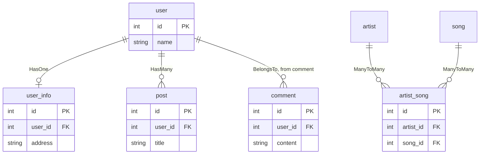

# Model

A model is a Dart class for one database table.
You read, create, change and delete rows through the model.
A model has all the [query builder](../query-builder.md) methods too.

## Create a model

```bash
dox create:model Blog      # only the model
dox create:model Blog -m   # the model and a migration for the table `blogs`
```

This makes `lib/app/models/blog/blog.model.dart`.
`make:model` is another name for the same command.

The model code uses a generated class (`BlogGenerator`).
Run the generator after you make or change a model:

```bash
dart run build_runner build
```

`dart run build_runner watch` runs the generator again each time you save a file.

## A model

```dart title="lib/app/models/blog/blog.model.dart"
import 'package:dox_orm/dox_orm.dart';

part 'blog.model.g.dart'; // (1)!

@DoxModel() // (2)!
class Blog extends BlogGenerator { // (3)!
  @Column() // (4)!
  String? title;

  @Column(beforeSave: makeSlug) // (5)!
  String? slug;

  @Column()
  String? status;

  @Column(name: 'body') // (6)!
  String? description;

  @Column(name: 'user_id')
  int? userId;

  static String? makeSlug(Map<String, dynamic> map) {
    return map['title']?.toString().toLowerCase().replaceAll(' ', '-');
  }
}
```

1.  `build_runner` writes this file. It holds the generated `BlogGenerator` class.
2.  Marks the class as a model. The options, like `table` and `softDelete`, go here.
    The table is `blog` by default: the class name in snake_case.
3.  The generated class gives the model `id`, `createdAt` and `updatedAt`, and the query builder methods.
4.  One `@Column()` field is one table column. The column name is the field name in snake_case.
5.  `beforeSave` runs this static function before a save. It gets all values and returns the value for this column.
6.  `name` sets the column name when it is not the snake_case of the field. `description` reads and writes `body`.

- The model gets an `id` field, and `createdAt` and `updatedAt` fields. You do not declare them.
- Each `@Column()` field is one table column.
- Make every column field nullable (`String?`, `int?`). A new model has no values yet.

## Model options

All options go in `@DoxModel(...)`.

| Option | Default | What it does |
|---|---|---|
| `table` | class name in snake_case | The table name. |
| `primaryKey` | `'id'` | The primary key column. |
| `primaryKeyType` | `int` | The Dart type of the primary key, like `String` for a UUID. |
| `createdAt` | `'created_at'` | The column that keeps the create time. |
| `updatedAt` | `'updated_at'` | The column that keeps the last update time. |
| `timestamps` | `true` | `false` turns off `createdAt` and `updatedAt`. |
| `softDelete` | `false` | `delete()` sets `deleted_at` and keeps the row. |

### `table`

The default table name is the class name in snake_case, and singular.
`Blog` uses `blog`, and `BlogPost` uses `blog_post`.

```dart
@DoxModel(table: 'blogs')
class Blog extends BlogGenerator {}
```

!!! info
    `dox create:model Blog -m` sets `table: 'blogs'` for you,
    because the migration makes the plural table `blogs`.

### `primaryKey`

```dart
@DoxModel(primaryKey: 'uid')
class Blog extends BlogGenerator {}
```

The field name is the key in camelCase. With `primaryKey: 'blog_id'`, the field is `blogId`.

### `primaryKeyType`

The primary key field is `int?` by default.
Use `primaryKeyType` for another type, like a UUID string.

```dart
@DoxModel(primaryKey: 'uuid', primaryKeyType: String)
class Device extends DeviceGenerator {}
```

```dart
Device device = Device();
device.uuid = '0b6f2c1e-1a2b-4c3d-8e9f-001122334455';
await device.save(); // insert
```

`save()` inserts a new model, also when you set the key yourself.
It updates a model that was read from the table or saved before.
`model.exists` tells which one it is.

### `createdAt` and `updatedAt`

`save()` sets these columns to the current UTC time.
Use the options when your columns have other names.

```dart
@DoxModel(createdAt: 'created', updatedAt: 'modified')
class Blog extends BlogGenerator {}
```

Read the values with `blog.createdAt` and `blog.updatedAt`.

### `timestamps`

Set `timestamps: false` when the table has no `created_at` and `updated_at` columns.

```dart
@DoxModel(timestamps: false)
class Setting extends SettingGenerator {}
```

To turn off only one of them, set it to `null`, like `@DoxModel(updatedAt: null)`.

### `softDelete`

```dart
@DoxModel(softDelete: true)
class Blog extends BlogGenerator {}
```

The table needs a nullable `deleted_at` column. In a migration, add `table.softDeletes();`.

- `delete()` sets `deleted_at` to the current time. The row stays in the table.
- Queries do not return soft deleted rows. Use `withTrash()` to get them too.
- `forceDelete()` really deletes the row.
- `restore()` sets `deleted_at` back to `NULL`.

## Columns

### Column name

The default column name is the field name in snake_case.
Use `name` when the column has another name.

```dart
@Column()
String? userId; // column: user_id

@Column(name: 'body')
String? description; // column: body
```

### Field types

The field type tells Dox how to read the value.

| Field type | Column |
|---|---|
| `String?` | text, varchar |
| `int?` | integer types |
| `double?` | float, double. MySQL also gives `DECIMAL` as `double`. Postgres gives `numeric` as `String`. |
| `bool?` | boolean |
| `DateTime?` | date, datetime, timestamp |
| `Map<String, dynamic>?` or `List<dynamic>?` | JSON |

For other conversions, use `beforeSave` and `beforeGet`.

### `beforeSave` and `beforeGet`

These options take a static function of the model class.
The function gets a map and returns the value.

- `beforeSave` runs before a save. It gets the model values (column name => value).
  It returns the value to save in this column.
- `beforeGet` runs when a row is read. It gets the row from the database.
  It returns the value for this field.

```dart
@DoxModel()
class Blog extends BlogGenerator {
  @Column()
  String? title;

  // beforeSave: make the slug from the title
  @Column(beforeSave: makeSlug)
  String? slug;

  // beforeGet: old rows have no status, show them as draft
  @Column(beforeGet: readStatus)
  String? status;

  static String? makeSlug(Map<String, dynamic> map) {
    return map['title']?.toString().toLowerCase().replaceAll(' ', '-');
  }

  static String? readStatus(Map<String, dynamic> map) {
    return map['status'] as String? ?? 'draft';
  }
}
```

## Save

`save()` inserts a new model, or updates a model that has an id.

```dart
// insert
Blog blog = Blog();
blog.title = 'My first blog';
await blog.save();
print(blog.id); // the new id

// update
Blog? found = await Blog().find(1);
found?.title = 'New title';
await found?.save();

// set a field to null
found?.slug = null;
await found?.save(); // slug is now NULL in the database

// create from a map
Blog created = await Blog().create(<String, dynamic>{
  'title': 'My first blog',
  'status': 'draft',
});
```

- On insert, `null` fields are not sent, so the database default is used.
- On update, only the fields that changed are sent.
  A field is compared to its value from the last load or save.
  A `Map` or `List` field is always sent, because it can change in place.
- When nothing changed, `save()` runs no query, and `updated_at` stays as it is.
- On update, a field is set to `NULL` only when it had a value before
  (loaded from the database, or saved).
  Fields that were not loaded, for example with `select()`, are not changed.
- On insert, `save()` runs one `INSERT`. It reads the new id from the
  insert, so there is no `SELECT` after it.
- `save()` returns `false` when a [model event](events.md) cancels it.

### Mass assignment

`create()`, `insert()` and `update()` take any key of the map.
So `User().create(req.body)` with `{"is_admin": 1}` makes an admin.
Set `fillable` or `guarded` to stop this.

```dart
@DoxModel()
class User extends UserGenerator {
  // only these keys are taken from a map
  @override
  List<String> get fillable => <String>['name', 'email'];

  // or: these keys are never taken from a map
  @override
  List<String> get guarded => <String>['is_admin'];
}
```

- Keys that are not allowed are dropped. They do not throw.
- Both lists are empty by default. Then every key is taken.
- `save()` is not changed. Fields you set in code are always saved.

## Delete

```dart
// delete a record
Blog? blog = await Blog().find(1);
await blog?.delete(); // deletes only this record

// force delete
Blog? trashed = await Blog().withTrash().find(1);
await trashed?.forceDelete(); // deletes the row, also with softDelete

// restore
Blog? deleted = await Blog().withTrash().find(1);
await deleted?.restore(); // sets deleted_at back to NULL
```

`save()`, `delete()`, `forceDelete()` and `restore()` fire [model events](events.md).

## Convert to a map or JSON

```dart
Blog? blog = await Blog().find(1);

Map<String, dynamic>? map = blog?.toMap();  // all columns and computed values
Map<String, dynamic>? json = blog?.toJson(); // the same, without hidden fields
Map<String, dynamic>? row = blog?.toMap(original: true); // the raw database row
```

`jsonEncode(blog)` uses `toJson()`.
So you can return a model, or a list of models, from a controller.

### Hide fields

Fields in `hidden` are left out of `toJson()`.
Use the column names.

```dart
@DoxModel()
class User extends UserGenerator {
  @override
  List<String> get hidden => <String>['password', 'remember_token'];
}
```

### Computed values

A computed value is a getter that is added to `toJson()` and `toMap()`.
It is like `$appends` with an accessor in Laravel.

Add `@Computed()` to a getter in the model, then run `dart run build_runner build`.

```dart
@DoxModel()
class User extends UserGenerator {
  @Column(name: 'first_name')
  String? firstName;

  @Column(name: 'last_name')
  String? lastName;

  @Computed() // json key: full_name
  String get fullName => '$firstName $lastName';

  @Computed(name: 'initials') // custom json key
  String get shortName => '${firstName?[0]}${lastName?[0]}';
}
```

```dart
User? user = await User().find(1);
print(user?.toJson());
// {id: 1, first_name: John, last_name: Wick, ..., full_name: John Wick, initials: JW}
```

- The default key is the getter name in snake_case (`fullName` becomes `full_name`).
- A computed value is **never a column**. It is not read from the database,
  and it is not sent in `INSERT` or `UPDATE`.
- `hidden` also hides computed values. Use the json key, for example `['full_name']`.
- Computed values of loaded relations are in the nested JSON too.
- `toMap(original: true)` returns the raw database row, so it has no computed values.
- A getter runs each time `toJson()` or `toMap()` is called, so keep it fast.

!!! info "No reflection"
    `build_runner` makes the code. There is no reflection at run time.
    A model without `@Computed()` does no extra work in `toJson()`.

## New query

A model object keeps the parts of its query (`where`, `orderBy`, ...).
`query()` gives a new, empty model, so you can start another query.

```dart
Blog blog = Blog();
List<Blog> active = await blog.where('status', 'active').get();

// a new query, without the where above
List<Blog> deleted = await blog.query().where('status', 'deleted').get();
```

## Debug

`debug(true)` prints the SQL of this model in the terminal.

```dart
Blog blog = Blog();
blog.debug(true);
blog.title = 'John Wick';
await blog.save();
```

## Relationships

A model can load related models.
See [HasOne](relationship/has-one.md), [HasMany](relationship/has-many.md),
[BelongsTo](relationship/belongs-to.md) and [ManyToMany](relationship/many-to-many.md).

The relationship pages use these tables:


