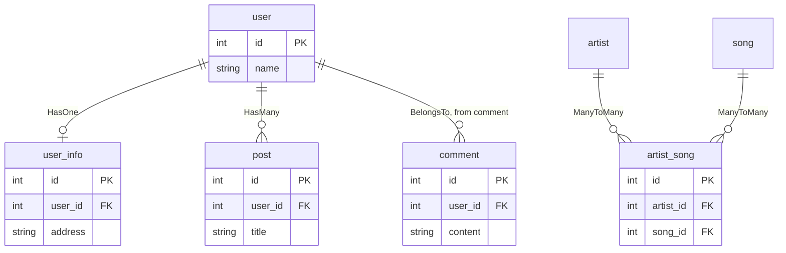

# Model

A model is a Dart class for one database table, used to read, create, change and delete its rows.

Each model maps to one table, and each object of the model is one row. A model also has all the [query builder](../query-builder.md) methods, so you can query the table through it.

## Generating models

Use `make:model` to make a new model. The `-m` option also makes a migration for the table:

```bash
dox make:model Blog      # only the model
dox make:model Blog -m   # the model and a migration for the table `blogs`
dox make:model Blog -a   # the model, a migration, a factory, a seeder and a resource controller
```

This makes `lib/app/models/blog/blog.model.dart`. Other options are `-c` (controller), `-r` (resource controller), `--api` (resource controller without `create` and `edit`), `-f` (factory) and `-s` (seeder). You can join them, like `-mfs`. See the [CLI reference](../../reference/cli.md#dox-makemodel).

A model uses a generated class (`BlogGenerator`), so you must run the generator after you make or change a model:

```bash
dart run build_runner build
```

If you want it to run again each time you save a file, use `dart run build_runner watch`.

## Defining models

A model is a class with `@DoxModel()`. Each `@Column()` field is one column of the table:

```dart title="lib/app/models/blog/blog.model.dart"
import 'package:dox_orm/dox_orm.dart';

part 'blog.model.g.dart'; // (1)!

@DoxModel() // (2)!
class Blog extends BlogGenerator { // (3)!
  @Column() // (4)!
  String? title;

  @Column(beforeSave: makeSlug) // (5)!
  String? slug;

  @Column()
  String? status;

  @Column(name: 'body') // (6)!
  String? description;

  @Column(name: 'user_id')
  int? userId;

  static String? makeSlug(Map<String, dynamic> map) {
    return map['title']?.toString().toLowerCase().replaceAll(' ', '-');
  }
}
```

1.  `build_runner` writes this file. It holds the generated `BlogGenerator` class.
2.  Marks the class as a model. The options, like `table` and `softDelete`, go here.
3.  The generated class gives the model `id`, `createdAt` and `updatedAt`, and the query builder methods.
4.  The column name is the field name in snake_case. Digits stay as they are: `address2` is `address2`.
5.  `beforeSave` runs this static function before a save. See [Changing values on save and read](#changing-values-on-save-and-read).
6.  Use `name` when the column name is not the snake_case of the field. The name is used exactly as written.

Make every column field nullable (`String?`, `int?`), because a new model has no values yet.

### Table names

The default table name is the class name in snake_case and singular: `Blog` uses `blog`, and `BlogPost` uses `blog_post`. With the [`pluralTableNames` flag](../index.md#orm-flags) it is plural. If your table has another name, set `table`:

```dart
@DoxModel(table: 'blogs')
class Blog extends BlogGenerator {}
```

`dox make:model Blog` always sets `table: 'blogs'` for you, and the migration from `-m` uses the same table.

### Primary keys

The primary key is `id` by default. If your key has another name, set `primaryKey`. The field name is the key in camelCase, so `blog_id` becomes `blogId`:

```dart
@DoxModel(primaryKey: 'uid')
class Blog extends BlogGenerator {}
```

The key field is `int?` by default. If your key is a UUID string, set `primaryKeyType`:

```dart
@DoxModel(primaryKey: 'uuid', primaryKeyType: String)
class Device extends DeviceGenerator {}
```

```dart
Device device = Device();
device.uuid = '0b6f2c1e-1a2b-4c3d-8e9f-001122334455';
await device.save(); // insert
```

`save()` inserts a new model, even when you set the key yourself.

### Timestamps

`save()` sets `created_at` and `updated_at` to the current UTC time. You read them with `blog.createdAt` and `blog.updatedAt`. If your columns have other names, set them:

```dart
@DoxModel(createdAt: 'created', updatedAt: 'modified')
class Blog extends BlogGenerator {}
```

If the table has no timestamp columns, turn them off. To turn off only one, set it to `null`, like `@DoxModel(updatedAt: null)`:

```dart
@DoxModel(timestamps: false)
class Setting extends SettingGenerator {}
```

### Column types

The field type tells Dox how to read the value:

| Field type | Column |
|---|---|
| `String?` | text, varchar |
| `int?` | integer types |
| `double?` | float, double. MySQL also gives `DECIMAL` as `double`. Postgres gives `numeric` as `String`. |
| `bool?` | boolean, or a number like `tinyint` (0 is false) |
| `DateTime?` | date, datetime, timestamp |
| `Map<String, dynamic>?` or `List<dynamic>?` | JSON |
| an enum, like `Status?` | text with the enum name |

For other types, use a [cast](casts.md).

### Changing values on save and read

Sometimes a column needs a small change when you save or read it. `beforeSave` and `beforeGet` take a static function of the model. The function gets a map and returns the value:

- `beforeSave` gets the model values (column name => value) and returns the value to save.
- `beforeGet` gets the row from the database and returns the value for the field.

```dart
@DoxModel()
class Blog extends BlogGenerator {
  @Column()
  String? title;

  // beforeSave: make the slug from the title
  @Column(beforeSave: makeSlug)
  String? slug;

  // beforeGet: old rows have no status, show them as draft
  @Column(beforeGet: readStatus)
  String? status;

  static String? makeSlug(Map<String, dynamic> map) {
    return map['title']?.toString().toLowerCase().replaceAll(' ', '-');
  }

  static String? readStatus(Map<String, dynamic> map) {
    return map['status'] as String? ?? 'draft';
  }
}
```

## Retrieving models

A model has all the [query builder](../query-builder.md) methods, so you read rows with them:

```dart
Blog? found = await Blog().find(1);
```

### Starting a new query

A model object keeps the parts of its query (`where`, `orderBy`, ...). If you want to start another query from it, use `query()`. It gives a new, empty model:

```dart
Blog blog = Blog();
List<Blog> active = await blog.where('status', 'active').get();

// a new query, without the where above
List<Blog> deleted = await blog.query().where('status', 'deleted').get();
```

### Refreshing models

Sometimes the row changed in the database after you read it. `refresh()` reads the row again into this model, and loads its relations again. `fresh()` gives a new model of the row and leaves this one as it is:

```dart
Blog? blog = await Blog().find(1);
await blog!.refresh();          // this model now has the values of the table
Blog? now = await blog.fresh(); // a new model, or null when the row is gone
```

## Inserting and updating models

### Inserts

To add a row, make a new model, set its fields and call `save()`:

```dart
Blog blog = Blog();
blog.title = 'My first blog';
await blog.save();
print(blog.id); // the new id
```

Fields that are `null` are not sent, so the database default is used.

### Updates

`save()` also updates a model that was read from the table or saved before. Only the fields that changed are sent:

```dart
Blog? found = await Blog().find(1);
found?.title = 'New title';
await found?.save();
```

To clear a column, set the field to `null` and save:

```dart
found?.status = null;
await found?.save(); // status is now NULL in the database
```

`model.exists` tells you if `save()` will insert or update. `save()` returns `false` when a [model event](events.md) cancels it.

### Creating from a map

`create()` makes a new row from a map and returns the model as it is in the table. The model needs `fillable`, see [Mass assignment](#mass-assignment):

```dart
Blog created = await Blog().create(<String, dynamic>{
  'title': 'My first blog',
  'status': 'draft',
});
```

`create()` works like `save()` on a new model: it saves only the `@Column` fields, runs `beforeSave`, sets the timestamps and fires the [model events](events.md).

To change some columns of a loaded model from a map, use `blog.update(<String, dynamic>{...})`. It changes only that row and sets `updated_at`, but it fires no model events.

### Mass assignment

`create()`, `insert()`, `update()`, `upsert()` and the find or create methods take their keys from a map. If they took every key, `User().create(req.body)` with `{"is_admin": 1}` would make an admin. So a model is guarded by default, and you must say which keys may come from a map:

```dart
@DoxModel()
class User extends UserGenerator {
  // only these keys are taken from a map
  @override
  List<String> get fillable => <String>['name', 'email'];

  // or: every key but these is taken from a map
  @override
  List<String> get guarded => <String>['is_admin'];
}
```

- With `fillable`, other keys are dropped.
- A model with no `fillable` (and the default `guarded`) throws a `MassAssignmentException` when it gets a map with keys.
- Fields you set in code and save with `save()` are always saved.

If you want to take every key, set `guarded` to an empty list. This is not safe with user input:

```dart
@override
List<String> get guarded => const <String>[];
```

#### Skip the fillable check

Sometimes your own code must set a guarded column, like `is_admin`. These methods ignore `fillable` and `guarded`, so never pass user input like `req.body` to them.

`forceCreate()` creates a row with every key of the map:

```dart
User admin = await User().forceCreate(<String, dynamic>{'name': 'Ann', 'is_admin': true});
```

`forceUpdate()` updates the rows of a query with every key of the map:

```dart
await User().where('id', 1).forceUpdate(<String, dynamic>{'is_admin': true});
```

`forceFill()` sets fields on a model. It does not save, so call `save()` after it:

```dart
User? user = await User().find(1);
await user!.forceFill(<String, dynamic>{'is_admin': true}).save();
```

`Model.unguarded()` turns the check off for everything inside the callback. Other requests that run at the same time still use `fillable`. Await everything inside the callback, because work that finishes later also runs with the check off:

```dart
await Model.unguarded(() async {
  await User().create(<String, dynamic>{'name': 'Bob', 'is_admin': true});
  await User().where('id', 2).update(<String, dynamic>{'is_admin': true});
});
```

### Find or create

Sometimes you want a row if it exists, and a new one if it does not. These methods find a row by the first map. When there is no row, they use both maps.

`firstOrCreate()` finds the row, or creates it:

```dart
User user = await User().firstOrCreate(
  <String, dynamic>{'email': 'ann@example.com'},
  <String, dynamic>{'name': 'Ann'},
);
```

`firstOrNew()` finds the row, or makes a new model that is not saved yet:

```dart
User other = await User().firstOrNew(<String, dynamic>{'email': 'bob@example.com'});
if (!other.exists) {
  await other.save();
}
```

`updateOrCreate()` updates the row, or creates it:

```dart
User updated = await User().updateOrCreate(
  <String, dynamic>{'email': 'ann@example.com'},
  <String, dynamic>{'name': 'Ann Lee'},
);
```

`firstOrCreate()` and `updateOrCreate()` fire the [model events](events.md). `firstOrNew()` does not save, so no event fires. See also the [query builder](../query-builder.md#finding-or-creating-a-row).

### Incrementing and decrementing

If you want to add to a number column, like a view count, use `increment()` and `decrement()`. They change the column in one query, and the model field gets the new value too:

```dart
Blog? blog = await Blog().find(1);
await blog!.increment('views');      // views + 1
await blog.increment('views', 5);    // views + 5
await blog.decrement('views');       // views - 1
print(blog.views);
```

They return the number of changed rows. They fire no model events and do not set `updated_at`.

### Touch and replicate

`touch()` sets `updated_at` to now. Give a column name to set another column. It fires the save events, and `touchQuietly()` does the same with no events:

```dart
Blog? blog = await Blog().find(1);
await blog!.touch();               // updated_at = now
await blog.touch('published_at');  // published_at = now
```

`replicate()` makes an unsaved copy of a model. It has no primary key and no timestamps, so `save()` inserts a new row. Relations are not copied:

```dart
Blog? blog = await Blog().find(1);
Blog copy = blog!.replicate()..title = 'Copy of ${blog.title}';
await copy.save();
```

If you do not want some columns in the copy, list them. They are set to `null`:

```dart
Blog other = blog.replicate(<String>['slug']);
```

### Checking changed columns

Sometimes you need to know what changed before or after a save. A model tracks this. The names are column names, like `user_id`, not the Dart field names:

```dart
Blog? blog = await Blog().find(1);
blog!.title = 'New title';

blog.isDirty();                     // true
blog.isDirty('title');              // true
blog.isDirty(<String>['body']);     // false
blog.isClean('body');               // true
blog.getDirty();                    // {title: New title}
blog.getOriginal('title');          // the old title
```

After a save, `wasChanged()` and `getChanges()` tell you what the last save changed:

```dart
await blog.save();
blog.wasChanged('title');           // true
blog.getChanges();                  // {title: New title, updated_at: ...}
```

## Deleting models

Call `delete()` on a model to delete its row. It returns the number of deleted rows: `1`, or `0` when the row was not there or a [model event](events.md) cancelled it:

```dart
Blog? blog = await Blog().find(1);
int count = await blog!.delete(); // deletes only this record
```

A model with no primary key value throws a `StateError` and runs no query, so `Blog().delete()` can not delete every row by mistake. To delete the rows of a query, add a `where`, like `Blog().where('status', 'draft').delete()`. A [global scope](scopes.md#global-scopes) counts as a `where`. To delete every row on purpose, see [write every row](../query-builder.md#writing-every-row).

### Soft deleting

Sometimes you want to keep deleted rows, so you can bring them back later. Turn on `softDelete`:

```dart
@DoxModel(softDelete: true)
class Blog extends BlogGenerator {}
```

The table needs a nullable `deleted_at` column. In a migration, add `table.softDeletes();`.

Now `delete()` sets `deleted_at` to the current time and keeps the row. Queries leave out soft deleted rows. Use `withTrash()` to get them too, or `onlyTrashed()` to get only them.

`trashed()` tells you if a model is soft deleted, and `restore()` brings it back:

```dart
Blog? blog = await Blog().withTrash().find(1);
if (blog!.trashed()) await blog.restore();
```

To really remove a soft deleted row, use `forceDelete()`:

```dart
Blog? trashed = await Blog().withTrash().find(1);
await trashed?.forceDelete(); // deletes the row, also with softDelete
```

## Converting to a map or JSON

`toMap()` gives all columns and computed values. `toJson()` gives the same without hidden fields:

```dart
Blog? blog = await Blog().find(1);

Map<String, dynamic>? map = blog?.toMap();  // all columns and computed values
Map<String, dynamic>? json = blog?.toJson(); // the same, without hidden fields
Map<String, dynamic>? row = blog?.toMap(original: true); // the raw database row
```

`jsonEncode(blog)` uses `toJson()`, so you can return a model, or a list of models, from a controller.

### Hide fields

You should never send fields like a password to the client. Put them in `hidden`, and `toJson()` leaves them out. Use the column names:

```dart
@DoxModel()
class User extends UserGenerator {
  @override
  List<String> get hidden => <String>['password', 'remember_token'];
}
```

If you prefer a list of the fields to keep, use `visibleFields`. When it is empty (the default), every field is kept:

```dart
@override
List<String> get visibleFields => const <String>['id', 'name'];
```

To change this for one model, or for a list of models, use `makeHidden()` and `makeVisible()`. `makeVisible()` also shows a field that is in `hidden`:

```dart
return user.makeVisible(<String>['email']).toJson();
return users.makeHidden(<String>['phone']);
```

### Computed values

Sometimes you want a value in the JSON that is not a column, like a full name. Add `@Computed()` to a getter, then run `dart run build_runner build`:

```dart
@DoxModel()
class User extends UserGenerator {
  @Column(name: 'first_name')
  String? firstName;

  @Column(name: 'last_name')
  String? lastName;

  @Computed() // json key: full_name
  String get fullName => '$firstName $lastName';

  @Computed(name: 'initials') // custom json key
  String get shortName => '${firstName?[0]}${lastName?[0]}';
}
```

```dart
User? user = await User().find(1);
print(user?.toJson());
// {id: 1, first_name: John, last_name: Wick, ..., full_name: John Wick, initials: JW}
```

The key is the getter name in snake_case, or the `name` you give. A computed value is never read from or written to the database. `hidden` also hides it, by its json key. The getter runs each time `toJson()` or `toMap()` is called, so keep it fast.

## Relationships

A model can load related models. See [HasOne](relationship/has-one.md), [HasMany](relationship/has-many.md), [BelongsTo](relationship/belongs-to.md), [ManyToMany](relationship/many-to-many.md), [HasManyThrough](relationship/through.md) and [Polymorphic](relationship/polymorphic.md).

The relationship pages use these tables:



### Preloading nested relations

A dot path also loads the relations of the loaded rows. It runs one query for each level:

```dart
List<User> users = await User().preload('posts.comments').get();
```

### Filtering a preload

If you want only some related rows, give a callback. It adds conditions to the query of the relation. With a dot path, it is for the last relation:

```dart
await User().preload('posts', (QueryBuilder<dynamic> q) {
  q.where('published', true);
}).get();
```

```dart
// all posts, and only the approved comments of each post
await User().preload('posts.comments', (QueryBuilder<dynamic> q) {
  q.where('approved', true);
}).get();
```

### Saving through a relation

These methods save a related model and set the foreign key for you. They work with `@HasMany`, `@HasOne`, `@MorphMany` and `@MorphOne`:

```dart
Blog blog = (await Blog().find(1))!;
Comment c = await blog.createRelated<Comment>('comments', <String, dynamic>{'body': 'hi'});
await blog.saveRelated('comments', Comment()..body = 'hi');
await blog.saveManyRelated('comments', <Comment>[c1, c2]);
```

`createRelated()` uses `create()`, so `fillable`, events and timestamps work. The foreign key does not need to be in `fillable`.

For a `@BelongsTo`, `comment.associate('blog', blog)` sets the key and `comment.dissociate('blog')` sets it to `null`. Call `save()` after them.

## Debugging queries

If you want to see the SQL of a model, use `debug(true)`. It prints the SQL in the terminal:

```dart
Blog blog = Blog();
blog.debug(true);
blog.title = 'John Wick';
await blog.save();
```

## Details

This section is for special cases. Most apps do not need it.

### All options

All options go in `@DoxModel(...)`.

| Option | Default | What it does |
|---|---|---|
| `table` | class name in snake_case | The table name. |
| `primaryKey` | `'id'` | The primary key column. |
| `primaryKeyType` | `int` | The Dart type of the primary key, like `String` for a UUID. |
| `createdAt` | `'created_at'` | The column that keeps the create time. |
| `updatedAt` | `'updated_at'` | The column that keeps the last update time. |
| `timestamps` | `true` | `false` turns off `createdAt` and `updatedAt`. |
| `softDelete` | `false` | `delete()` sets `deleted_at` and keeps the row. |

### Saving

- `create()` can write `NULL` for a key that is `null` in the map, with the [`createWritesNull` flag](../index.md#orm-flags).
- On update, a field is compared to its value from the last load or save. A `Map` or `List` field is always sent, because it can change in place.
- On update, a field is set to `NULL` only when it had a value before. Fields that were not loaded, for example with `select()`, are not changed.
- When nothing changed, `save()` runs no query and `updated_at` stays as it is. It still fires `updating` and `updated`, unless the [`skipCleanUpdateEvents` flag](../index.md#orm-flags) is on.
- When you set `updatedAt` yourself, `save()` keeps your value.
- `getChanges()` and `wasChanged()` also count `update()`, `increment()`, `decrement()`, `touch()`, `restore()` and a soft delete on the model as a save.
- A soft delete and `restore()` also set `updated_at` when the model has timestamps.

### Mass assignment

- `forceFill()` skips a key that is not a column. A value of the wrong type throws an `ArgumentError`.
- `Model.unguarded()` also covers timers, futures that are not awaited and stream listeners that start inside the callback.
- A query `update()` keeps the check, so `update(req.body)` stays safe.
- Model events that fire inside `forceCreate()` and `forceUpdate()` also run with the check off. So a `create()` or `update()` inside such a hook skips `fillable` too.

### Increment, touch and replicate

- A third argument to `increment()` sets other columns in the same query: `increment('views', 1, <String, dynamic>{'status': 'hot'})`. Keys that `fillable` and `guarded` do not allow are dropped.
- `touch()` returns the number of changed rows. It returns `0` when the model has no `updated_at` column and you give no column, or when a hook throws `CancelModelEvent`.
- `replicate()` copies `deleted_at`, so a copy of a soft deleted model is soft deleted too. A column in its list that can not be `null`, or that is not a column, throws an `ArgumentError`.

### Rows with no primary key

`update()`, `increment()`, `decrement()`, `touch()` and `delete()` on a model with no primary key value and no `where` throw a `StateError`. This happens on a model that was never saved, or that was read without its key.

### Refreshing

- `refresh()` and `fresh()` read by primary key from the write database. They find a soft deleted row too, and skip global scopes.
- `refresh()` throws a `StateError` on a model that is not in the table, and a `ModelNotFoundException` when the row is gone.

### Relations after a reload

`await user.reload()` and a preload set the relation fields again, also when there is no related row. A to-one field that can be `null` becomes `null`. A to-many field becomes `[]`. A to-one field that can not be `null` keeps its old value.

### Other cases

- `create:model` is another name for `make:model`.
- Computed values of loaded relations are in the nested JSON too. `toMap(original: true)` has no computed values.

## See also

- [HasMany](relationship/has-many.md): connect one model to many.
- [Query scopes](scopes.md): keep a query you use often in the model.
- [Model events](events.md): run code when a model is saved or deleted.
- [Factories](../factories.md): make test rows.
