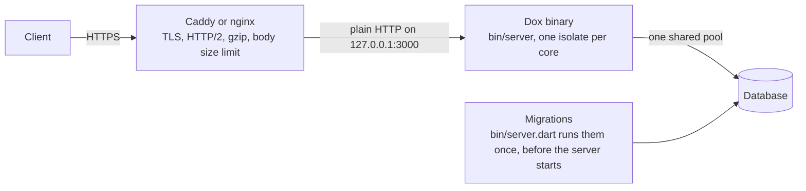

# Deployment

This page shows how to build a Dox app for production and run it safely.

!!! danger "Never run production with `dart run`"
    `dart run` (and `dox serve`) uses the JIT compiler. It is made for
    development. It uses about 25x more memory at start (around 390 MB
    instead of 16 MB) and starts slower. Always build an AOT binary for
    production.

## Build

```bash
dox build
```

This makes a `build/bundle/` folder:

| File                        | What it is                                       |
| --------------------------- | ------------------------------------------------ |
| `build/bundle/bin/server`   | the native binary. No Dart SDK needed to run it  |
| `build/bundle/bin/queue`    | the queue worker, when `bin/queue.dart` exists   |
| `build/bundle/bin/schedule` | the scheduler, when `bin/schedule.dart` exists   |
| `build/bundle/lib/`         | native libraries from build hooks (eg. SQLite)   |
| `build/bundle/db/`          | your `db/` folder (migrations, seeders). SQLite database files are left out |
| `build/bundle/.env.example` | copy it to `build/bundle/.env`, or use env variables |

`dox build` runs `build_runner` (when your app uses it), then
`dart build cli --target bin/server.dart --output build`. It builds
`bin/queue.dart` and `bin/schedule.dart` the same way, when they exist.
It exits with code 1 when a step fails, so CI can stop.

!!! warning "Not `dart compile exe`"
    `dox_orm` depends on `sqlite3` v3. It bundles SQLite with a build hook.
    `dart compile exe` does not run build hooks, so it stops with an error.
    `dart build cli` is the same AOT compiler and runs the hooks.
    Keep `bin/` and `lib/` together: the binary loads the libraries from `../lib`.

Start it:

```bash
cd build/bundle
./bin/server
```

The binary reads `.env` and `db/` from the folder you start it in.
A real environment variable wins over the `.env` file.

A new Dox app runs the migrations in `bin/server.dart`, before the server starts.
So the database is up to date when the first request comes in.

## Docker

A new Dox app has this multi-stage `Dockerfile`. The final image is `FROM scratch`: only the Dart AOT runtime, the bundle, `db/`, `libgcc_s` and an empty `/tmp`.

```dockerfile
FROM dart:stable AS build
WORKDIR /app
COPY pubspec.* ./
RUN dart pub get
COPY . .
RUN dart pub get --offline
RUN dart run build_runner build --delete-conflicting-outputs
RUN dart build cli --target bin/server.dart --output build

# the queue worker and the scheduler are binaries too
RUN dart build cli --target bin/queue.dart --output build/queue \
  && cp build/queue/bundle/bin/queue build/bundle/bin/ \
  && dart build cli --target bin/schedule.dart --output build/schedule \
  && cp build/schedule/bundle/bin/schedule build/bundle/bin/

RUN mkdir -p /out/app/storage /out/tmp \
  && chmod 1777 /out/tmp \
  && cp -r build/bundle/. /out/app/ \
  && cp -r db /out/app/db \
  # the native HTTP server (Rust) needs libgcc_s, which /runtime/ does not have
  && LIBGCC=$(find / -name libgcc_s.so.1 -path '*lib*' | head -n 1) \
  && mkdir -p /out$(dirname $LIBGCC) && cp $LIBGCC /out$LIBGCC

FROM scratch
COPY --from=build /runtime/ /
COPY --from=build /out/ /
WORKDIR /app
EXPOSE 3000
CMD ["/app/bin/server"]
```

The image has no `.env` file, so secrets stay out of it. Pass config as
environment variables:

```bash
docker build -t my-app .
docker run -p 3000:3000 --env-file .env -e DB_HOST=... my-app
```

A new app also has a `docker-compose.yml`. It runs the app and Postgres, and reads `.env` with `env_file: .env`:

```bash
docker compose up -d --build
```

A new `.env` uses SQLite. To use the Postgres of the compose file, set `DB_CONNECTION=postgres` and `DB_NAME` (for example `postgres`) in `.env`.

The queue worker and the scheduler run as their own processes. In the image, start them with `/app/bin/queue work` and `/app/bin/schedule work`.
See [Docker](../guides/docker.md) for a health check in the image.

## HTTPS: put a proxy in front

Dox serves plain HTTP only. Its [native server](native-server.md) has no TLS.

Run Dox on plain HTTP on a private port. Put [Caddy](https://caddyserver.com)
or nginx in front of it. The proxy does TLS, HTTP/2 and gzip.

By default Dox listens on all network interfaces. When the proxy runs on the
same machine, set `APP_HOST=127.0.0.1`. Then the app port can not be reached
from outside.



Then tell Dox to trust the proxy, so `req.ip()` and `req.scheme()` show the
real client:

```dart
AppConfig(
  /// the proxy's IP, or a range like '10.0.0.0/8', or '172.16.0.0/12' for docker
  trustedProxies: <String>['127.0.0.1', '::1'],
);
```

- `req.ip()` reads `X-Forwarded-For`. Dox walks the list from the right and
  skips your proxies, so a fake value from the client is ignored.
- `req.scheme()` reads `X-Forwarded-Proto` (`http` or `https`).
  `req.isSecure()` is true for `https`.
- `trustedProxies` is empty by default. Then Dox ignores those headers,
  because any client can send them.
- `['*']` trusts any direct client. Only use it when the app port is not
  reachable from outside. With `*`, `req.ip()` is the right-most
  `X-Forwarded-For` hop, the one your proxy added. If you have two proxies
  in a row, list their IPs or ranges instead.

### Caddy

Caddy gets a certificate for you and sets `X-Forwarded-For` and
`X-Forwarded-Proto`. Websockets work with no extra config.

```
example.com {
  encode gzip
  reverse_proxy 127.0.0.1:3000
}
```

### Nginx

```nginx
upstream dox {
  server 127.0.0.1:3000;
  keepalive 64;
}

map $http_upgrade $connection_upgrade {
  default upgrade;
  ''      '';
}

server {
  listen 443 ssl http2;
  server_name example.com;

  ssl_certificate     /etc/letsencrypt/live/example.com/fullchain.pem;
  ssl_certificate_key /etc/letsencrypt/live/example.com/privkey.pem;

  # match maxMultipartSize in AppConfig
  client_max_body_size 100m;

  gzip on;
  gzip_types application/json text/plain text/css application/javascript;

  location / {
    proxy_pass http://dox;
    proxy_http_version 1.1;

    # websocket upgrade
    proxy_set_header Upgrade $http_upgrade;
    proxy_set_header Connection $connection_upgrade;

    proxy_set_header Host $host;
    proxy_set_header X-Real-IP $remote_addr;
    proxy_set_header X-Forwarded-For $proxy_add_x_forwarded_for;
    proxy_set_header X-Forwarded-Proto $scheme;

    # stream uploads to Dox, do not buffer them in nginx first
    proxy_request_buffering off;
  }
}

server {
  listen 80;
  server_name example.com;
  return 301 https://$host$request_uri;
}
```

## Keep it running

When a worker isolate dies, Dox starts it again. When the main isolate dies,
the process exits with a non-zero code (see [Isolate](isolate.md#when-an-isolate-crashes)).
Let a supervisor restart it: `restart: unless-stopped` in Docker compose,
or `Restart=always` in systemd.

```ini
# /etc/systemd/system/dox.service
[Service]
WorkingDirectory=/srv/app/build/bundle
ExecStart=/srv/app/build/bundle/bin/server
EnvironmentFile=/srv/app/build/bundle/.env
Restart=always

[Install]
WantedBy=multi-user.target
```

## Graceful shutdown

On `SIGTERM` (docker stop, Kubernetes, Cloud Run, Fly, systemd) or `SIGINT` (Ctrl+C), Dox stops gracefully, in every isolate:

1. It stops taking new connections at once.
2. Open requests can finish. Each keep-alive connection closes after its current answer.
3. After `shutdownTimeout` (default 8 seconds), it closes the connections that are still open.
4. It runs `shutdown()` of every provider (see [Providers](providers.md#clean-up-on-shutdown)). The `ORMProvider` of a new project closes the database connections here.
5. It closes the cache stores of `Cache()`, eg. the Redis connections.
6. The process exits with code `0`.

A second `SIGINT` or `SIGTERM` stops the process at once.

Set the timeout in `lib/config/app.dart`:

```dart
AppConfig(
  shutdownTimeout: Duration(seconds: 20),
  ...
)
```

Keep it shorter than the time your platform waits before it kills the process:

| Platform | Waits | Change it with |
| --- | --- | --- |
| `docker stop` | 10 seconds | `docker stop -t 30`, or `stop_grace_period` in compose |
| Kubernetes | 30 seconds | `terminationGracePeriodSeconds` |
| Cloud Run | 10 seconds | can not be changed |
| Fly.io | 5 seconds | `kill_timeout` in `fly.toml` |
| systemd | 90 seconds | `TimeoutStopSec` |

In code, `await Dox().stop()` does steps 1 to 5 and does not exit.

## Many processes or machines

One Dox process already uses every core. You only need more processes to
run on more machines, or to restart one process without downtime.
Run each one on its own port (or machine) and list them in the proxy:

```nginx
upstream dox {
  server 10.0.0.11:3000;
  server 10.0.0.12:3000;
  keepalive 64;
}
```

Socket.IO rooms then need a shared adapter (like Redis), because each
process has its own memory.
