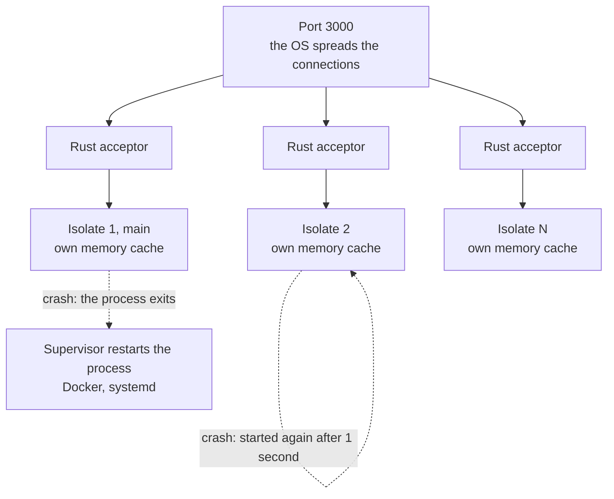

# Isolate

This page explains how Dox runs your app on many isolates (threads), and what that means for your code.

## How it works

Dox starts many isolates. Each one runs its own HTTP server on the same port. The operating system spreads the connections between them.

- Native server on Linux: each isolate has its own socket (`SO_REUSEPORT`).
- Native server on macOS: the isolates share one socket.
- Native server on Windows: only one isolate serves HTTP.

With the native server, each isolate has its own Rust acceptor on the port:



With the native Postgres and MySQL drivers (the default), all isolates share one database pool in Rust. With the Dart drivers, each isolate has its own pool. See [How Dox works](../concepts/how-dox-works.md#where-the-database-pools-live).

See [Native server](native-server.md) for the two servers.

## How many isolates

By default Dox starts one isolate per CPU core (`Platform.numberOfProcessors`). So one process uses the whole machine.

To change it, set `totalIsolate` in `lib/config/app.dart`. A new app reads it from `APP_TOTAL_ISOLATE`:

```dart title="lib/config/app.dart"
AppConfig appConfig = AppConfig(
  // ...
  totalIsolate: env.appTotalIsolate ?? Platform.numberOfProcessors,
);
```

You can also set it in code, before `startServer()`. This wins over the config:

```dart title="bin/server.dart"
Dox().initialize(appConfig);
Dox().totalIsolate(2);
await Dox().startServer();
```

Use fewer isolates when:

- the machine also runs the database or other heavy work, or
- you use WebSocket rooms without the Redis adapter. A room only reaches clients on the same isolate. Use `1`, or see [WebSocket](websocket.md).

## Each isolate has its own memory

Isolates do not share memory. This has some effects on your code:

- A static value or a singleton exists once **per isolate**. When you change it in one isolate, the others do not see it.
- The `memory` cache store is per isolate. Use the `redis` store to share cache data. See [Cache](cache.md).
- To share data between isolates or servers, use a database, Redis or files.

`Dox().isolateId` tells you which isolate runs the code. The first isolate is `1`.

## What each isolate does at start

Dox copies the `AppConfig`, the services and the routes you added before `startServer()` to each new isolate. Then every isolate:

1. runs `setup()` of each service (for example, it opens the database pool),
2. registers the routes of your routers,
3. reads the parameter types of each controller once,
4. starts its HTTP server.

This happens once at start, not on each request.

Because the config and services are copied, they must not hold open sockets or database pools. Open these in `setup()`. See [Services](services.md).

## When an isolate crashes

- An error in a request is caught. Dox sends a `500` and keeps going.
- An async error outside a request (for example a future that nobody awaits) is caught and passed to `errorHandler`. The isolate keeps running.
- If a worker isolate still dies, Dox prints `[dox] isolate N exited, restarting` to stderr. It starts a new isolate after 1 second.
- If the first (main) isolate dies, the process exits with a non-zero code. Let a supervisor start it again, like Docker `restart:` or systemd `Restart=always`. See [Deployment](deployment.md#keep-it-running).
