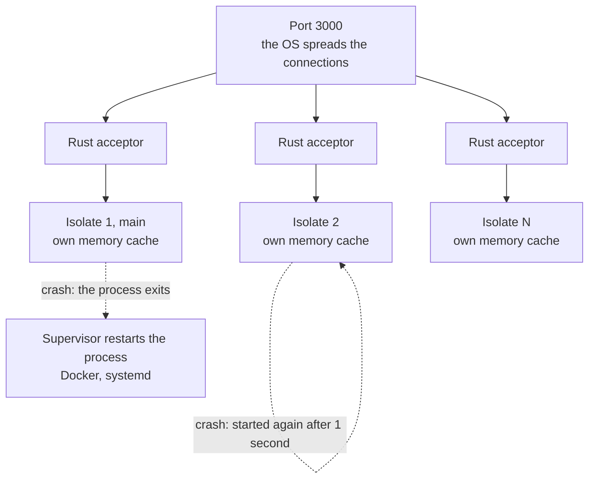

# Isolate

Dox runs your app on many isolates (threads) at once, so it can use every CPU core.

Each isolate runs its own [native server](native-server.md) on the same port, and the operating system spreads the connections between them:



## Setup

Dox starts one isolate per CPU the process may use. In a container, it uses the CPU limit, and a quota rounds up: 1.5 CPUs gives 2 isolates. On Windows only one isolate serves HTTP.

To change the number, set `totalIsolate` in the app config. A new app reads it from `APP_TOTAL_ISOLATE`:

```dart title="lib/config/app.dart"
AppConfig appConfig = AppConfig(
  // ...
  totalIsolate: env.appTotalIsolate,
);
```

## Setting the number in code

Call `Dox().totalIsolate()` before `startServer()`. It wins over the config:

```dart title="bin/server.dart"
Dox().initialize(appConfig);
Dox().totalIsolate(2);
await Dox().startServer();
```

## Each isolate has its own memory

A static value, a singleton and the `memory` cache store exist one time per isolate. To share data between isolates or servers, use a database, Redis or files.

## Finding the current isolate

`Dox().isolateId` is the id of the isolate that runs your code. The first isolate is 1. `Dox().isolateCount` is the number of running isolates:

```dart
int id = Dox().isolateId;
int count = Dox().isolateCount;
```

## Sending a message to the other isolates

`IsolateBus` sends a message from one isolate to all the other isolates in the same process. Listen in the `setup()` of a provider, and publish from anywhere:

```dart
IsolateBus.instance.on('users').listen(onMessage);
IsolateBus.instance.publish('users', <Object>['changed', 42]);
```

An isolate never gets its own message, and a listener gets only the messages sent after it started to listen. A message must be a value a `SendPort` can send, or `publish` throws an `ArgumentError`.

`IsolateBus.instance.size` is the number of isolates that listen, this one included. For many servers, use Redis. [Socket.IO](../packages/socketio.md#many-isolates) uses the bus to share broadcasts.

## What each isolate does at start

Dox copies the `AppConfig`, the providers and the routes to each new isolate. Then every isolate:

1. runs `setup()` of each provider,
2. registers the routes of your routers,
3. reads the parameter types of each controller one time,
4. runs `boot()` of each provider,
5. starts its HTTP server.

So the config and the providers must not hold open sockets or database pools. Open them in `setup()`. See [Providers](providers.md).

## Heavy CPU work

Heavy CPU work in a request blocks every other request on the same isolate. Run it on a worker isolate with `Dox().compute`:

```dart
Future<List<int>> renderPdf(Map<String, dynamic> data) {
  return Dox().compute(() => buildPdf(data));
}
```

The task can use only values that can go between isolates: numbers, strings, lists, maps and plain objects. It can not use the container, a database connection or a cache store, so read the data first and pass it in. Make the task in a small top-level or static function.

The tasks run on a pool of 4 workers, and more tasks wait in line. Set `computeWorkers` to change the number:

```dart
AppConfig(
  // ...
  computeWorkers: 8,
);
```

An error of the task is thrown at the `await`. `compute` also works with no server, like in a command, a test or a queue job.

## When an isolate crashes

An error in a request gives a 500, and an async error outside a request goes to the [exception handler](../the-basic/errors.md). If a worker isolate dies, Dox starts a new one after 1 second.

If the first isolate dies, the process exits with a non-zero code. Let a supervisor start it again, like Docker `restart:` or systemd `Restart=always`. See [Deployment](deployment.md#keep-it-running).

## Next steps

- [Providers](providers.md): code that runs in each isolate at start.
- [Native server](native-server.md): the HTTP server in each isolate.
- [Deployment](deployment.md): run the app on a server.
