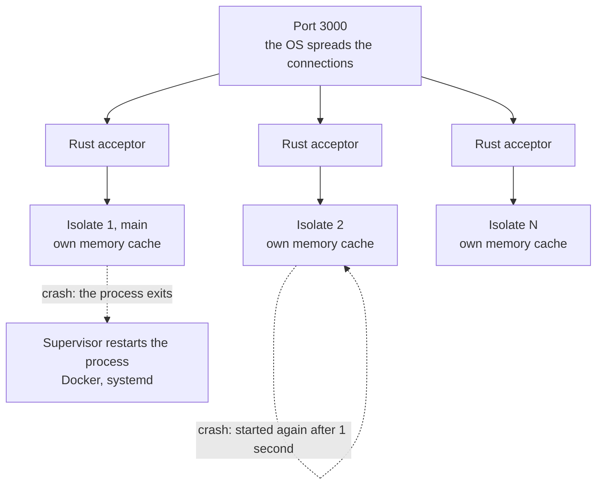

# Isolate

This page explains how Dox runs your app on many isolates (threads), and what that means for your code.

## How it works

Dox starts many isolates. Each one runs its own [native server](native-server.md) on the same port. The operating system spreads the connections between them.

- Linux: each isolate has its own socket (`SO_REUSEPORT`).
- macOS: the isolates share one socket.
- Windows: only one isolate serves HTTP.

Each isolate has its own Rust acceptor on the port:



With the Postgres and MySQL drivers, all isolates share one database pool in Rust. See [How Dox works](../concepts/how-dox-works.md#where-the-database-pools-live).

## How many isolates

By default Dox starts one isolate per CPU core (`Platform.numberOfProcessors`).

To change it, set `totalIsolate` in `lib/config/app.dart`. A new app reads it from `APP_TOTAL_ISOLATE`:

```dart title="lib/config/app.dart"
AppConfig appConfig = AppConfig(
  // ...
  totalIsolate: env.appTotalIsolate ?? Platform.numberOfProcessors,
);
```

You can also set it in code, before `startServer()`. This wins over the config:

```dart title="bin/server.dart"
Dox().initialize(appConfig);
Dox().totalIsolate(2);
await Dox().startServer();
```

Use fewer isolates when the machine also runs the database or other heavy work.

## Each isolate has its own memory

Isolates do not share memory:

- A static value or a singleton exists once **per isolate**. When you change it in one isolate, the others do not see it.
- The `memory` cache store is per isolate. See [Cache](cache.md).
- To share data between isolates or servers, use a database, Redis or files.

`Dox().isolateId` tells you which isolate runs the code. The first isolate is `1`.

## Send a message to the other isolates

`IsolateBus` sends a message from one isolate to all the others in the same process. Use it to tell them that something changed, for example "forget this cache key". Socket.IO uses it to share broadcasts (see [Socket.IO](../packages/socketio.md#many-isolates)).

```dart
IsolateBus.instance.on('users').listen(onMessage); // in a provider's setup()
IsolateBus.instance.publish('users', <Object>['changed', 42]);
```

- A message goes to one channel. A listener on `'users'` never gets the messages of another channel.
- An isolate never gets its own message.
- `Dox().isolateCount` is the number of isolates that run, in every isolate.
- `IsolateBus.instance.size` is the number of isolates that listen, this one included.
- A message must be something a `SendPort` can send: null, bool, num, String, typed data, and lists and maps of those.
- A value that a `SendPort` can not send throws an `ArgumentError` in `publish`. Then no isolate gets the message. In the main isolate it throws only when another isolate listens on the bus. With no other isolate there, nobody gets it and nothing throws.
- It works inside one process only. For many servers, use Redis.
- There is no backpressure. `publish` never waits. A slow listener gets the messages in a queue in its memory.
- A message reaches only the isolates that listen at that moment. An isolate that calls `on()` later does not get the messages sent before.
- `size` changes a little after an isolate joins or leaves. The new number comes in a message, so it can be old for a short time.

## What each isolate does at start

Dox copies the `AppConfig`, the providers and the routes you added before `startServer()` to each new isolate. Then every isolate:

1. runs `setup()` of each provider (for example, it opens the database pool),
2. registers the routes of your routers,
3. reads the parameter types of each controller once,
4. runs `boot()` of each provider,
5. starts its HTTP server.

Because the config and providers are copied, they must not hold open sockets or database pools. Open these in `setup()`. See [Providers](providers.md).

## When an isolate crashes

- An error in a request is caught. Dox sends a `500` and keeps going.
- An async error outside a request (for example a future that nobody awaits) is caught and passed to the `report` method of the [exception handler](../the-basic/errors.md). The isolate keeps running.
- If a worker isolate still dies, Dox prints `[dox] isolate N exited, restarting` to stderr. It starts a new isolate after 1 second.
- If the first (main) isolate dies, the process exits with a non-zero code. Let a supervisor start it again, like Docker `restart:` or systemd `Restart=always`. See [Deployment](deployment.md#keep-it-running).
