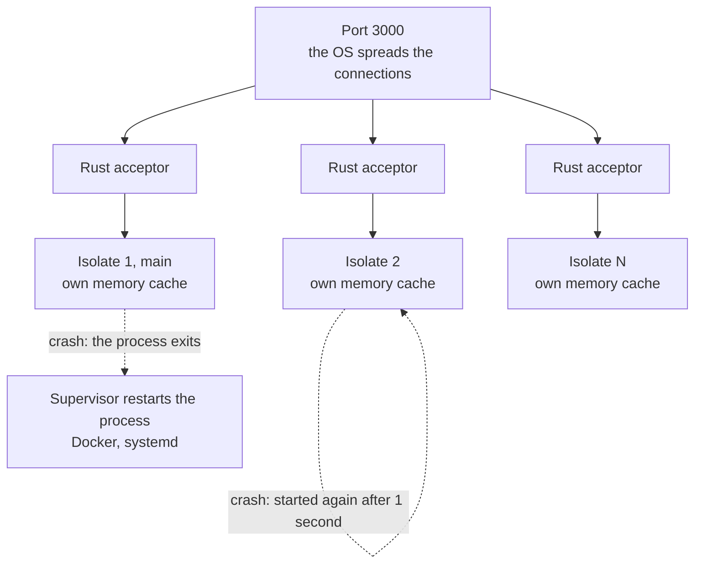

# Isolate

Dox runs your app on many isolates (threads) at once, so it can use every CPU core.

Each isolate runs its own [native server](native-server.md) on the same port, and the operating system spreads the connections between them. You write your app once, and Dox starts a copy of it in every isolate.



With the Postgres and MySQL drivers, all isolates share one database pool in Rust. See [How Dox works](../concepts/how-dox-works.md#where-the-database-pools-live).

## Setting the number of isolates

By default Dox starts one isolate per CPU core (`Platform.numberOfProcessors`). You may want fewer when the same machine also runs the database or other heavy work.

Set `totalIsolate` in the app config. A new app reads it from `APP_TOTAL_ISOLATE`:

```dart title="lib/config/app.dart"
AppConfig appConfig = AppConfig(
  // ...
  totalIsolate: env.appTotalIsolate ?? Platform.numberOfProcessors,
);
```

You can also set it in code, before `startServer()`. This wins over the config:

```dart title="bin/server.dart"
Dox().initialize(appConfig);
Dox().totalIsolate(2);
await Dox().startServer();
```

## Each isolate has its own memory

Isolates do not share memory. This matters when you keep state in your code:

- A static value or a singleton exists once **per isolate**. If you change it in one isolate, the others do not see it.
- The `memory` cache store is per isolate. See [Cache](cache.md).
- To share data between isolates or servers, use a database, Redis or files.

If you need to know which isolate runs your code, use `Dox().isolateId`. The first isolate is `1`:

```dart
int id = Dox().isolateId;
```

## Sending a message to the other isolates

Sometimes one isolate needs to tell the others that something changed, for example "forget this cache key". Use `IsolateBus` for this. It sends a message from one isolate to all the others in the same process.

Listen on a channel in a provider's `setup()`, and publish from anywhere:

```dart
IsolateBus.instance.on('users').listen(onMessage); // in a provider's setup()
IsolateBus.instance.publish('users', <Object>['changed', 42]);
```

A listener only gets the messages of its own channel, and an isolate never gets its own message. A message must be something a `SendPort` can send: null, bool, num, String, typed data, and lists and maps of those.

The bus works inside one process only. For many servers, use Redis. Socket.IO uses the bus to share broadcasts, see [Socket.IO](../packages/socketio.md#many-isolates).

## What each isolate does at start

Dox copies the `AppConfig`, the providers and the routes you added before `startServer()` to each new isolate. Then every isolate:

1. runs `setup()` of each provider (for example, it opens the database pool),
2. registers the routes of your routers,
3. reads the parameter types of each controller once,
4. runs `boot()` of each provider,
5. starts its HTTP server.

Because the config and providers are copied, they must not hold open sockets or database pools. Open these in `setup()`. See [Providers](providers.md).

## When an isolate crashes

Dox keeps your app running when code fails:

- An error in a request is caught. Dox sends a `500` and keeps going.
- An async error outside a request (for example a future that nobody awaits) is passed to the `report` method of the [exception handler](../the-basic/errors.md). The isolate keeps running.
- If a worker isolate still dies, Dox prints `[dox] isolate N exited, restarting` to stderr and starts a new isolate after 1 second.

If the first (main) isolate dies, the process exits with a non-zero code. So let a supervisor start it again, like Docker `restart:` or systemd `Restart=always`. See [Deployment](deployment.md#keep-it-running).

## Details

- Linux gives each isolate its own socket (`SO_REUSEPORT`). On macOS the isolates share one socket. On Windows only one isolate serves HTTP.
- `Dox().isolateCount` is the number of running isolates. `IsolateBus.instance.size` is the number of isolates that listen on the bus, this one included. `size` can be old for a short time after an isolate joins or leaves.
- `publish` throws an `ArgumentError` for a value a `SendPort` can not send, and then no isolate gets the message. In the main isolate it only throws when another isolate listens.
- `publish` never waits. A slow listener keeps the messages in a queue in its memory.
- A message only reaches the isolates that listen at that moment. An isolate that calls `on()` later does not get older messages.
