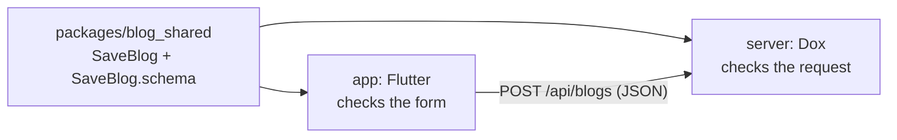

# Share code with Flutter

Put a `@Dto` class in a shared Dart package, so the Dox server and the Flutter app check input with the same rules and error messages.

The generated DTO code imports only `dox_validation`, which is pure Dart (no `dart:io`, no `dart:mirrors`). So it runs in Flutter and on the web.

## What you need

- A Dox app (`dox create server`). Here it is in the `server` folder.
- A Flutter app (`flutter create app`). Here it is in the `app` folder.

## The layout

```text
my_blog/
  packages/
    blog_shared/     # the DTOs. Pure Dart.
  server/            # the Dox app
  app/               # the Flutter app
```



## 1. The shared package

```yaml title="packages/blog_shared/pubspec.yaml"
name: blog_shared
description: DTOs shared by the Dox server and the Flutter app.
version: 0.1.0
publish_to: none

environment:
  sdk: ^3.13.0

dependencies:
  dox_validation: ^3.0.0-rc

dev_dependencies:
  build_runner: ^2.17.1
  dox_builder: ^3.0.0-rc
```

`dox_builder` is a dev dependency. It only runs when you generate code. The Flutter app does not get it.

Write the DTO. Import `dox_validation`, not `dox_core`:

```dart title="packages/blog_shared/lib/src/save_blog.dart"
import 'package:dox_validation/dox_validation.dart';

part 'save_blog.g.dart';

/// A new blog post. The server and the app check it with the same rules.
@Dto()
class SaveBlog {
  @Trim()
  @Length(min: 3, max: 255)
  final String title;

  @Trim()
  @MinLength(10)
  final String description;

  const SaveBlog({required this.title, required this.description});

  static const DtoSchema<SaveBlog> schema = $SaveBlogDto;
}
```

Export the DTOs. Also export `dox_validation`, so the app gets `ParseResult` and `ValidationException` from one import:

```dart title="packages/blog_shared/lib/blog_shared.dart"
export 'package:dox_validation/dox_validation.dart';

export 'src/save_blog.dart';
```

Generate the code:

```bash
cd packages/blog_shared
dart pub get
dart run build_runner build
```

This writes two files:

- `lib/src/save_blog.g.dart`: the checks, the converter and the JSON Schema of `SaveBlog`.
- `lib/generated/dtos.g.dart`: the list of every DTO in this package. The server uses it.

Commit both files. Then the Flutter app does not need to run the generator.

!!! warning "Rules that need the database stay on the server"
    `@Unique` and `@Exists` come from `dox_orm`. Do not use them in the shared package: the app can not import `dox_orm`.
    Check them on the server, in the service or in a server-only DTO.

## 2. The Dox server

Add the shared package to the dependencies of the server:

```yaml title="server/pubspec.yaml"
dependencies:
  # ... the packages of the new app stay
  blog_shared:
    path: ../packages/blog_shared
```

Run `dart pub get`.

Dox finds a DTO in the `dtos` list of `AppConfig`. The server's own `lib/generated/dtos.g.dart` lists only the DTOs in the server.
So add the list of the shared package too:

```dart title="server/lib/config/app.dart"
import 'package:blog_shared/generated/dtos.g.dart' as shared;
import 'package:dox_core/dox_core.dart';
import 'package:server/generated/dtos.g.dart';

AppConfig appConfig = AppConfig(
  // ...
  dtos: <DtoSchema<Object>>[...dtos, ...shared.dtos],
);
```

When the server has no DTOs of its own, its `dtos` list is empty. The line above still works.

The controller asks for `SaveBlog` like any other DTO. Dox checks the body before the method runs. Bad input gets `422`.

```dart title="server/lib/app/http/controllers/blog.controller.dart"
import 'package:blog_shared/blog_shared.dart' show SaveBlog;
import 'package:dox_core/dox_core.dart';

@Inject()
class BlogController {
  Future<Map<String, dynamic>> store(SaveBlog body) async {
    // body.title is already trimmed and checked.
    return <String, dynamic>{'title': body.title, 'saved': true};
  }
}
```

```dart title="server/lib/routes/api.dart"
Route.post('/blogs', (BlogController c) => c.store);
```

!!! note "Why `show SaveBlog`"
    `dox_core` has its own `ValidationException` (it answers `422`). `blog_shared` exports the one from `dox_validation`.
    `show` keeps only the DTO from `blog_shared`, so the two names do not clash in server code.

A bad request gets the errors as `{"key": "message"}`:

```text
POST /api/blogs  {"title": "ab", "description": "short"}
422 {"title":"The title must be between 3 and 255 characters","description":"The description must be at least 10 characters"}
```

## 3. The Flutter app

```yaml title="app/pubspec.yaml"
name: app
publish_to: none

environment:
  sdk: ^3.13.0

dependencies:
  flutter:
    sdk: flutter
  http: ^1.6.0
  blog_shared:
    path: ../packages/blog_shared
```

The app does not depend on `dox_core`.

The widget checks the form with `SaveBlog.schema.safeParse(...)` and sends the request only when the input is good.
`result.errors` has the same shape as the server's `422` body, so one `_errors` map shows both.

```dart title="app/lib/new_blog_form.dart"
import 'dart:convert';

import 'package:blog_shared/blog_shared.dart';
import 'package:flutter/material.dart';
import 'package:http/http.dart' as http;

class NewBlogForm extends StatefulWidget {
  const NewBlogForm({super.key});

  @override
  State<NewBlogForm> createState() {
    return _NewBlogFormState();
  }
}

class _NewBlogFormState extends State<NewBlogForm> {
  final TextEditingController _title = TextEditingController();
  final TextEditingController _description = TextEditingController();
  Map<String, String> _errors = <String, String>{};

  Future<void> _submit() async {
    ParseResult<SaveBlog> result = SaveBlog.schema.safeParse(<String, dynamic>{
      'title': _title.text,
      'description': _description.text,
    });
    if (!result.success) {
      setState(() {
        _errors = result.errors;
      });
      return;
    }

    http.Response response = await http.post(
      Uri.parse('https://api.example.com/api/blogs'),
      headers: <String, String>{'Content-Type': 'application/json'},
      body: jsonEncode(SaveBlog.schema.toMap(result.value!)),
    );
    setState(() {
      _errors = response.statusCode == 422
          ? Map<String, String>.from(jsonDecode(response.body) as Map)
          : <String, String>{};
    });
  }

  @override
  void dispose() {
    _title.dispose();
    _description.dispose();
    super.dispose();
  }

  @override
  Widget build(BuildContext context) {
    return Column(
      children: <Widget>[
        TextField(
          controller: _title,
          decoration: InputDecoration(labelText: 'Title', errorText: _errors['title']),
        ),
        TextField(
          controller: _description,
          decoration: InputDecoration(labelText: 'Description', errorText: _errors['description']),
        ),
        ElevatedButton(onPressed: _submit, child: const Text('Save')),
      ],
    );
  }
}
```

The schema also has `parse` (throws `ValidationException`), `toMap` (the JSON map to send) and `toJsonSchema`.
Use `safeParseAsync` or `parseAsync` when the DTO has an `async` `validate()` method.
See [Validation](../the-basic/validation.md) and [dox_validation](../packages/validation.md) for all rules and methods.
