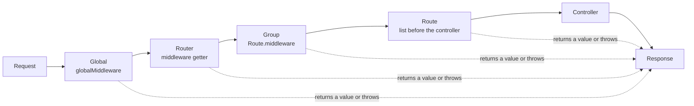

# Middleware

Middleware is code that runs before the controller, and if you want, after it too. Use it for checks like login, logging or rate limits, or to change the response.

## How it works

A middleware gets the request. It then does one of these:

- **Return the request.** Dox goes on to the next middleware, then to the controller.
- **Return something else** (a `String`, a `Map`, a `response(...)`). Dox sends it as the response. The controller does not run.
- **Throw an exception**, like `NotFoundHttpException()`. Dox sends the error response. See [Response: errors](response.md#errors).

A middleware can be `async`. Dox waits for it.

## Class based middleware

Create one with the CLI. It writes `lib/app/http/middleware/logger.middleware.dart`.

```bash
dox make:middleware Logger
```

```dart title="lib/app/http/middleware/logger.middleware.dart"
import 'package:dox_core/dox_core.dart';

class LoggerMiddleware implements IDoxMiddleware {
  @override
  dynamic handle(IDoxRequest req) {
    print('${req.method} ${req.uri.path}');
    return req; // go on to the next middleware
  }
}
```

Then put it on a route:

```dart title="lib/routes/api.dart"
Route.get('/ping', <dynamic>[LoggerMiddleware(), (WebController c) => c.pong]);
```

!!! note
    `handle` takes an `IDoxRequest`, not a `DoxRequest`.

## Function based middleware

A function that takes a `DoxRequest` also works as middleware.

```dart title="lib/app/http/middleware/api_key.middleware.dart"
import 'package:dox_core/dox_core.dart';

dynamic apiKeyMiddleware(DoxRequest req) {
  if (req.header('X-Api-Key') != 'secret') {
    return response(<String, String>{'message': 'Unauthorized'}).statusCode(401);
  }
  return req;
}
```

```dart title="lib/routes/api.dart"
Route.get('/ping', <dynamic>[apiKeyMiddleware, (WebController c) => c.pong]);
```

## Run code after the controller

A middleware can also get a `next` function. `await next()` runs the rest of the middleware and the controller, and gives the response.
Code after that line runs after the controller. Change the response, then return it.

```dart title="lib/app/http/middleware/see_other.middleware.dart"
import 'package:dox_core/dox_core.dart';

/// a redirect after a form post becomes 303, so the browser does a GET
class SeeOtherMiddleware implements IDoxNextMiddleware {
  @override
  Future<DoxResponse> handle(DoxRequest req, Next next) async {
    // before the controller
    DoxResponse res = await next();
    // after the controller
    if (res.status == 302 && req.httpRequest.method != 'GET') {
      res.statusCode(303);
    }
    return res;
  }
}
```

The response from `next()` is always a `DoxResponse`, so you can use all its methods:
`statusCode(...)`, `header(...)`, `cookie(...)`, `content(...)`.
Read the status with `res.status` (`null` means 200) and the headers with `res.headers`.

When the controller (or a later middleware) throws an error, `next()` does not throw.
It gives the error response from the [ExceptionHandler](errors.md), like a `404` or a `422`. So the code after `next()` always runs.

A function works too. It takes the request and `next`:

```dart
Future<DoxResponse> timerMiddleware(DoxRequest req, Next next) async {
  Stopwatch watch = Stopwatch()..start();
  DoxResponse res = await next();
  return res.header('X-Time', '${watch.elapsedMilliseconds}ms');
}
```

To stop early, return a response and do not call `next()`.

!!! note "Speed"
    A route with no `next` middleware runs exactly as before. Only routes that have one pay for the extra step.

## Many middleware on one route

Put them in the list before the controller. They run from left to right.
You can mix class and function middleware, with or without `next`.

```dart
Route.get('/ping', <dynamic>[
  LoggerMiddleware(),
  apiKeyMiddleware,
  (WebController c) => c.pong, // the controller is always last
]);
```

## Middleware for a group of routes

```dart
Route.middleware(<dynamic>[LoggerMiddleware()], () {
  Route.get('/me', controller.me);
  Route.post('/logout', controller.logout);
});
```

## Middleware for a router or for all routes

For one router, set its `middleware` list:

```dart title="lib/routes/api.dart"
class ApiRouter extends Router {
  @override
  String get prefix => 'api';

  @override
  List<dynamic> get middleware => <dynamic>[LoggerMiddleware()];

  @override
  void register() {
    // every route here runs LoggerMiddleware
  }
}
```

For all routes, set `globalMiddleware` in the app config:

```dart title="lib/config/app.dart"
AppConfig appConfig = AppConfig(
  globalMiddleware: <dynamic>[
    LogMiddleware(enabled: env.appEnv != 'production'),
  ],
  // ...
);
```

The order is: global middleware, then router middleware, then group middleware, then route middleware.



!!! tip "Built-in middleware"
    - `LogMiddleware` from `dox_core` writes one JSON log line per request. Body fields and headers whose name has `password`, `secret`, `token`, `authorization`, `cookie` or `api_key` in it (upper or lower case) are logged as `[REDACTED]`. Change the list with `redact:`. The new project turns it off when `APP_ENV` is `production`.
    - `AuthMiddleware` from `dox_auth` checks the JWT token. See [Authentication](../security/authentication.md).
    - `RateLimit` from `dox_core` answers `429` when a client sends too many requests. See [Rate limiting](../security/rate-limiting.md).
    - `SecurityHeaders` from `dox_core` adds safe headers like `X-Frame-Options` to every answer. See [Security headers](../security/security-headers.md).
    - `SessionMiddleware` from `dox_core` gives each request a session. See [Session](session.md).
    - `CsrfMiddleware` from `dox_core` stops cross site request forgery. See [CSRF protection](../security/csrf.md).
