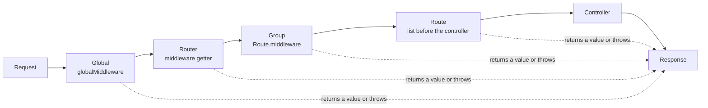

# Middleware

Middleware is code that runs before the controller, and if you want, after it too.

Use it for checks like login, logging or rate limits, or to change the response.

## How it works

A middleware gets the request. It then does one of these:

- **Return the request.** Dox goes on to the next middleware, then to the controller.
- **Return something else** (a `String`, a `Map`, a `response(...)`). Dox sends it as the response. The controller does not run.
- **Throw an exception**, like `NotFoundHttpException()`. Dox sends the error response. See [Response: errors](response.md#errors).

A middleware can be `async`. Dox waits for it.

## Class based middleware

Create one with the CLI. It writes `lib/app/http/middleware/logger.middleware.dart`.

```bash
dox make:middleware Logger
```

Write your code in `handle`. For example:

```dart title="lib/app/http/middleware/logger.middleware.dart"
import 'package:dox_core/dox_core.dart';

class LoggerMiddleware implements IDoxMiddleware {
  @override
  dynamic handle(IDoxRequest req) {
    print('${req.method} ${req.uri.path}');
    return req; // go on to the next middleware
  }
}
```

Then put it on a route:

```dart title="lib/routes/api.dart"
Route.get('/ping', <dynamic>[LoggerMiddleware(), (WebController c) => c.pong]);
```

!!! note
    `handle` takes an `IDoxRequest`, not a `DoxRequest`.

!!! warning
    Do not forget `return req`. A middleware that returns `null` ends the request with an empty `200`, and the controller does not run.
    When `APP_ENV` is `development` or `local`, Dox prints a warning to stderr the first time a middleware does this.

## Function based middleware

A function that takes a `DoxRequest` also works as middleware.

```dart title="lib/app/http/middleware/api_key.middleware.dart"
import 'package:dox_core/dox_core.dart';

dynamic apiKeyMiddleware(DoxRequest req) {
  String apiKey = Env.get<String>('API_KEY');
  String given = req.header('X-Api-Key') ?? '';
  if (apiKey.isEmpty || !Hash.equals(given, apiKey)) {
    return response(<String, String>{'message': 'Unauthorized'}).statusCode(401);
  }
  return req;
}
```

The key comes from the `API_KEY` env variable, not from the code.
`Hash.equals` takes the same time for every wrong key, so the time does not tell how much of the key was right. A normal `==` stops at the first wrong character.

```dart title="lib/routes/api.dart"
Route.get('/ping', <dynamic>[apiKeyMiddleware, (WebController c) => c.pong]);
```

## Run code after the controller

A middleware can also get a `next` function. `await next()` runs the rest of the middleware and the controller, and gives the response.
Code after that line runs after the controller. Change the response, then return it.

```dart title="lib/app/http/middleware/see_other.middleware.dart"
import 'package:dox_core/dox_core.dart';

/// a redirect after a form post becomes 303, so the browser does a GET
class SeeOtherMiddleware implements IDoxNextMiddleware {
  @override
  Future<DoxResponse> handle(DoxRequest req, Next next) async {
    // before the controller
    DoxResponse res = await next();
    // after the controller
    if (res.status == 302 && req.httpRequest.method != 'GET') {
      res.statusCode(303);
    }
    return res;
  }
}
```

The response from `next()` is always a `DoxResponse`, so you can use all its methods:
`statusCode(...)`, `header(...)`, `cookie(...)`, `content(...)`.
Read the status with `res.status` (`null` means 200) and the headers with `res.headers`.

When the controller (or a later middleware) throws an error, `next()` does not throw.
It gives the error response from the [ExceptionHandler](errors.md), like a `404` or a `422`. So the code after `next()` always runs.

A function works too. It takes the request and `next`:

```dart
Future<DoxResponse> timerMiddleware(DoxRequest req, Next next) async {
  Stopwatch watch = Stopwatch()..start();
  DoxResponse res = await next();
  return res.header('X-Time', '${watch.elapsedMilliseconds}ms');
}
```

To stop early, return a response and do not call `next()`.

!!! note "Speed"
    A route with no `next` middleware runs exactly as before. Only routes that have one pay for the extra step.

## Run code after the answer is sent

A middleware can run code after the answer has gone to the client, in its `terminate` method.
Use it for work the client should not wait for: logs, metrics, cleanup.
Implement `IDoxTerminableMiddleware`:

```dart title="lib/app/http/middleware/metrics.middleware.dart"
import 'package:dox_core/dox_core.dart';

class MetricsMiddleware implements IDoxMiddleware, IDoxTerminableMiddleware {
  @override
  dynamic handle(IDoxRequest req) => req; // before the controller

  @override
  void terminate(DoxRequest req, DoxResponse res) {
    // the answer is already sent
    print('${req.method} ${req.uri.path} ${res.status}');
  }
}
```

- `res.status` is the status that was sent, also for an error answer.
- `terminate` can be `async`.
- An error in `terminate` goes to `ExceptionHandler.report`. It never changes the answer.
- The `handle` part is not needed. A class can implement only `IDoxTerminableMiddleware`.

!!! note "Speed"
    Dox checks each route once for such a middleware. Other routes do not pay for it.

### From any code, with `AfterResponse`

A middleware needs to be on the route. `AfterResponse` lets any code (a controller, a service, a package) add work that runs after the answer of the current request is sent. The code does not need the request.

It is off by default. Turn it on once, in the `setup()` of a provider. `setup()` runs in every isolate.

```dart title="lib/providers/app_provider.dart"
@override
void setup() {
  AfterResponse.enable();
}
```

Then add work anywhere in the request:

```dart
AfterResponse.run(() => mailer.sendWelcome(user));
```

- The work runs after the answer is sent, one after the other, in the order it was added. The next one starts only when the one before it ends. So work that never ends blocks the rest of the work of that request.
- Outside a request, or when it is off, the work runs soon, after the code that runs now.
- An error in the work goes to `ExceptionHandler.report`. It never reaches the client and never stops the server.
- The work is not saved anywhere. When the server stops, work that did not run yet is lost. Use a [queue](../digging-deeper/queue.md) for work that must run. To run a queue job this way, see `dispatchAfterResponse()` in [Queue](../digging-deeper/queue.md#dispatch-a-job).

## Request id

`RequestId` gives each request an id. It is sent back in the `X-Request-Id` header, and you can read it as `req.requestId`.

```dart title="lib/config/app.dart"
AppConfig appConfig = AppConfig(
  globalMiddleware: <dynamic>[
    const RequestId(),
    LogMiddleware(enabled: true),
  ],
  // ...
);
```

- When the client (or a proxy) sends a safe `X-Request-Id` (1 to 128 characters of `A-Z a-z 0-9 . _ -`), Dox keeps it. Else it makes a new one of 32 hex characters.
- `RequestId(trustClient: false)` always makes a new one.
- `LogMiddleware` adds `http.request_id` to each log line. Put `RequestId` before it.
- The default `ExceptionHandler.report` prints the id with the error. In your own `report`, read `ExceptionHandler.requestId`.

## ETag and 304 Not Modified

`ETag` adds an `ETag` header to GET and HEAD answers. When the client sends the same ETag back in `If-None-Match`, Dox answers `304 Not Modified` with no body.

```dart
Route.get('/posts', <dynamic>[const ETag(), (PostController c) => c.index]);
```

- It works on `200` answers with a body in memory: a `String`, a `Map`, a `List` or a model. Files and streams are not touched.
- An answer that already has an `ETag` header or `Cache-Control: no-store` is not touched.
- The ETag is weak (`W/"..."`), made from a fast 64-bit hash of the body. It is not a secure hash.
- The controller still runs. A `304` saves bandwidth, not server time.

## Request timeout

`RequestTimeout` answers `503 Service Unavailable` when the middleware after it and the controller take too long.

```dart
Route.get('/report', (ReportController c) => c.show)
    .timeout(Duration(seconds: 30));

// the same as
Route.get('/report', <dynamic>[
  RequestTimeout(Duration(seconds: 30)),
  (ReportController c) => c.show,
]);
```

The answer is the normal error JSON:

```json
{"code": "request_timeout", "message": "The request took too long"}
```

- For every route, add `RequestTimeout(...)` to `globalMiddleware`.
- Dart can not stop a running Future. The controller keeps running in the background. Its late result is dropped, so nothing is sent twice.
- It is `503`, not `504`. `504 Gateway Timeout` is what a proxy sends when the app is slow. `503` says the app itself gave up.

## Server timing

`ServerTiming` adds a `Server-Timing` header to the answer. The browser dev tools show it in the Network tab, under Timing.

```dart title="lib/config/app.dart"
AppConfig appConfig = AppConfig(
  globalMiddleware: <dynamic>[
    if (Env.get<String>('APP_ENV') == 'development') const ServerTiming(),
  ],
  // ...
);
```

It always sends two times, in milliseconds:

- `handler`: the time in the controller.
- `total`: the time of the middleware after `ServerTiming` and the controller.

Add your own times to the current request from any code. You do not pass the request:

```dart
ServerTiming.add('db', Duration(milliseconds: 4));

String html = await ServerTiming.measure('render', () => view.render());
```

The header looks like this:

```
Server-Timing: db;dur=4.10;desc="3 calls", handler;dur=12.34, total;dur=13.02
```

- `add` with the same name again adds the times together. With more than one call, the text shows the count, like `"3 calls"`. Pass `description:` to set your own text.
- `measure` runs the function and adds the time it took, also when it throws.
- Without the middleware, or outside a request, `add` and `measure` do nothing. The cost is one small lookup.
- A name may only have letters, digits and ``!#$%&'*+-.^_`|~``. Other characters become `_`. An empty name is ignored.
- One answer keeps at most 32 names, plus `handler` and `total`.
- `handler` and `total` are kept for the built-in times. If your code adds a time named `total` or `handler`, it is sent as `app_total` or `app_handler`. It does not change the built-in times. If you also add a time named `app_total`, the two are added together.
- If the answer already has a `Server-Timing` header (set with `res.header`), the times are added after it, like `cdn;dur=1, handler;dur=12.34, total;dur=13.02`.

To add the time of every database query, listen to the queries once, for example in `setup()` of a provider. The listener runs inside the request that made the query, so `add` finds that request:

```dart title="lib/providers/query_timing_provider.dart"
import 'package:dox_core/dox_core.dart';
import 'package:dox_orm/dox_orm.dart'; // SqlQueryBuilder and QueryEvent

void onQuery(QueryEvent event) {
  ServerTiming.add('db', event.time);
}

/// Dox finds every DoxProvider class,
/// see lib/generated/container.g.dart.
class QueryTimingProvider extends DoxProvider {
  @override
  void setup() {
    SqlQueryBuilder().listen(onQuery);
  }
}
```

Each `listen` call adds the listener again. If `setup()` runs a second time (for example in tests), the time of each query is counted twice. Call `SqlQueryBuilder().removeListener(onQuery)` first, or when you are done.

The header then shows the total query time and the count, like `db;dur=4.10;desc="3 calls"`. See [Listen to queries](../database/index.md#listen-to-queries).

!!! warning "Development or trusted clients only"
    The header tells every client how long your code takes. An attacker can use that, for example to guess if an email has an account. `ServerTiming` is off unless you add it. Turn it on in development, or only for clients you trust.

## Many middleware on one route

Put them in the list before the controller. They run from left to right.
You can mix class and function middleware, with or without `next`.

```dart
Route.get('/ping', <dynamic>[
  LoggerMiddleware(),
  apiKeyMiddleware,
  (WebController c) => c.pong, // the controller is always last
]);
```

## Middleware for a group of routes

```dart
Route.middleware(<dynamic>[LoggerMiddleware()], () {
  Route.get('/me', (AuthController c) => c.me);
  Route.post('/logout', (AuthController c) => c.logout);
});
```

## Middleware for a router or for all routes

For one router, set its `middleware` list:

```dart title="lib/routes/api.dart"
class ApiRouter extends Router {
  @override
  String get prefix => 'api';

  @override
  List<dynamic> get middleware => <dynamic>[LoggerMiddleware()];

  @override
  void register() {
    // every route here runs LoggerMiddleware
  }
}
```

For all routes, set `globalMiddleware` in the app config:

```dart title="lib/config/app.dart"
AppConfig appConfig = AppConfig(
  globalMiddleware: <dynamic>[
    LogMiddleware(enabled: env.appEnv != 'production'),
  ],
  // ...
);
```

The order is: global middleware, then router middleware, then group middleware, then route middleware.



!!! tip "Built-in middleware"
    - `LogMiddleware` from `dox_core` logs one line per request through `Logger`.
        - It follows `LoggerConfig`: `enabled`, `level` and `prettyPrint`.
        - If the logger is off, `LogMiddleware(enabled: true)` does not turn logs on.
        - `enabled: false` turns only the request logs off. Leave it unset to follow the logger.
        - With `prettyPrint` it prints colored text.
        - Without it, it prints one JSON line with `status`, `message`, `network.client.ip`, `http.method`, `http.url`, `http.request_id` and `payload`.
        - The `filter` can change `status`, `message` and the other fields. It can not change `timestamp` or `logger`: `Logger` sets them. A `logger` key is ignored, also when the logger name is empty.
        - Headers are logged only with `withHeader: true`.
        - Body fields and headers whose name has a word like `password`, `secret`, `token`, `authorization`, `cookie` or `api_key` in it (upper or lower case) are logged as `[REDACTED]`. Change the list with `redact:`.
        - The new project turns it off when `APP_ENV` is `production`.
    - `AuthMiddleware` from `dox_auth` checks the JWT token. `AuthMiddleware(optional: true)` lets guests through too. `GuestMiddleware` lets only guests through, for login pages. See [Authentication](../security/authentication.md).
    - `RateLimit` from `dox_core` answers `429` when a client sends too many requests. See [Rate limiting](../security/rate-limiting.md).
    - `SecurityHeaders` from `dox_core` adds safe headers like `X-Frame-Options` to every answer. See [Security headers](../security/security-headers.md).
    - `SessionMiddleware` from `dox_core` gives each request a session. See [Session](session.md).
    - `CsrfMiddleware` from `dox_core` stops cross site request forgery. See [CSRF protection](../security/csrf.md).
    - `RequestId`, `ETag`, `RequestTimeout` and `ServerTiming` from `dox_core`. See above.
    - `ValidateSignature` from `dox_core` checks signed urls. See [Signed URLs](../security/signed-urls.md).
