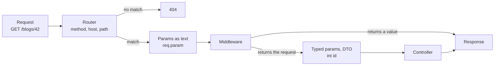

# Routing

A route connects a URL and an HTTP method to the code that answers it.

This is the path of one request through the router:



## Where routes live

Routes are in the `lib/routes` folder. Each file has one `Router` class.
The `prefix` of the router is added in front of all its routes.

```dart title="lib/routes/api.dart"
import 'package:dox_core/dox_core.dart';

class ApiRouter extends Router {
  @override
  String get prefix => 'api';

  @override
  List<dynamic> get middleware => <dynamic>[];

  @override
  void register() {
    Route.get('/ping', (DoxRequest req) => 'pong'); // GET /api/ping
  }
}
```

Add each router to `routers` in `lib/config/app.dart`:

```dart title="lib/config/app.dart"
AppConfig appConfig = AppConfig(
  routers: <Router>[WebRouter(), ApiRouter()],
  // ...
);
```

The leading `/` in a path is optional. `'ping'` and `'/ping'` are the same route.

## Route methods

```dart
Route.get('/blogs', controller.index);
Route.post('/blogs', controller.store);
Route.put('/blogs/{id}', controller.update);
Route.patch('/blogs/{id}', controller.update);
Route.delete('/blogs/{id}', controller.destroy);
```

!!! info
    There are also `Route.options`, `Route.copy`, `Route.view`, `Route.link`, `Route.unlink`,
    `Route.purge`, `Route.lock`, `Route.unlock` and `Route.propfind`.

## The handler

The second argument is the code that answers the request. It can be:

```dart
// a function
Route.get('/ping', (DoxRequest req) => 'pong');

// a controller method
WebController webController = WebController();
Route.get('/ping', webController.pong);

class WebController {
  String pong(DoxRequest req) {
    return 'pong';
  }
}

// a list: middleware first, the controller last
Route.get('/ping', <dynamic>[LoggerMiddleware(), webController.pong]);
```

In a list, the last item is the controller. The items before it are [middleware](middleware.md).

See [Controller](controller.md) for the parameters a handler can ask for.

## Route params

Put a param in `{}`. Ask for it as a typed parameter in the controller.

```dart
Route.get('/blogs/{id}', controller.show);

class BlogController {
  Future<Blog?> show(int id) async {
    return Blog().find(id);
  }
}
```

`/blogs/abc` answers `404`, because `abc` is not an `int`.
See [Controller: parameters](controller.md#parameters) for all the rules.

### Optional param

`{name?}` can be missing. Use a nullable type.

```dart
Route.get('/posts/{page?}', (int? page) {
  return 'page ${page ?? 1}'; // GET /posts and GET /posts/2 both match
});
```

### Catch-all param

`{name*}` matches the rest of the path, with slashes.

```dart
Route.get('/docs/{page*}', (String page) {
  return page; // GET /docs/a/b/c gives 'a/b/c'
});
```

## Group routes

```dart
// by prefix
Route.group('/blogs', () { // (1)!
  Route.get('/', controller.index);     // GET /blogs
  Route.get('/{id}', controller.show); // (2)!
});

// by domain: these routes match only when the Host header is dartondox.com
Route.domain('dartondox.com', () { // (3)!
  Route.get('/ping', controller.ping);
});

// by middleware
Route.middleware(<dynamic>[AuthMiddleware()], () { // (4)!
  Route.get('/me', controller.me);
  Route.post('/logout', controller.logout);
});
```

1.  `/blogs` goes in front of every path in the callback. Start both parts with `/`.
    The text is joined as it is.
2.  Makes `GET /blogs/{id}`. `{id}` is a route param. The controller asks for it as `int id`.
3.  These routes match only when the `Host` header is `dartondox.com`. Other hosts get `404`.
4.  `AuthMiddleware` runs before `me` and `logout`. It runs after the global and router middleware.

!!! warning "Start group paths with `/`"
    `Route.group` joins the text as it is. `Route.group('blogs', ...)` with `Route.get('all', ...)`
    makes `blogsall`. Write `Route.group('/blogs', ...)` and `Route.get('/all', ...)`.

To turn CORS on or off for some routes, see [CORS](../security/cors.md).

## Resource routes

One line makes the usual CRUD routes for a controller.

```dart
Route.resource('blogs', BlogController());
```

| Method | Path | Controller method |
| --- | --- | --- |
| `GET` | `/blogs` | `index` |
| `GET` | `/blogs/create` | `create` |
| `POST` | `/blogs` | `store` |
| `GET` | `/blogs/{id}` | `show` |
| `GET` | `/blogs/{id}/edit` | `edit` |
| `PUT`, `PATCH` | `/blogs/{id}` | `update` |
| `DELETE` | `/blogs/{id}` | `destroy` |

A method that the controller does not have is skipped. No route is made for it.
See [Resource controller](controller.md#resource-controller) to make one with the CLI.

## Serve storage files

`Route.files(path)` serves the files of a storage disk at `GET <path>/{key*}`.
By default only signed URLs work. Other requests get `403`.
See [File Storage](../digging-deeper/file-storage.md#serve-local-signed-urls).

```dart
Route.files('files');
Route.files('public', disk: 'local', signed: false);
```

## Request body for the docs

`post`, `put` and `patch` take a `body:` schema. It shows in the [OpenAPI docs](../packages/openapi.md).
It does **not** check the request. To check input, use a [DTO](validation.md).

```dart
Route.post('/posts', controller.store, body: v.object(<String, Schema<Object?>>{
  'title': v.string().min(3),
}));
```
