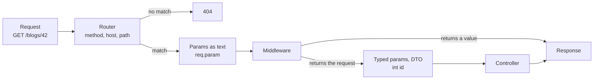

# Routing

A route connects a URL and an HTTP method to the code that answers it.

This is the path of one request through the router:



## Where routes live

Routes are in the `lib/routes` folder. Each file has one `Router` class.
The `prefix` of the router is added in front of all its routes.

```dart title="lib/routes/api.dart"
import 'package:dox_core/dox_core.dart';

class ApiRouter extends Router {
  @override
  String get prefix => 'api';

  @override
  List<dynamic> get middleware => <dynamic>[];

  @override
  void register() {
    Route.get('/ping', (DoxRequest req) => 'pong'); // GET /api/ping
  }
}
```

Dox finds every `Router` class by itself. It is in `lib/generated/container.g.dart` after `dart run build_runner build`.
To pick the order of routers, list them in `routers:` of `AppConfig`.
See [Dependency injection: routers and services](dependency-injection.md#routers-and-services).

The leading `/` in a path is optional. `'ping'` and `'/ping'` are the same route.

## Route methods

```dart
Route.get<BlogController>('/blogs', (BlogController c) => c.index);
Route.post<BlogController>('/blogs', (BlogController c) => c.store);
Route.put<BlogController>('/blogs/{id}', (BlogController c) => c.update);
Route.patch<BlogController>('/blogs/{id}', (BlogController c) => c.update);
Route.delete<BlogController>('/blogs/{id}', (BlogController c) => c.destroy);
```

!!! info
    There are also `Route.options`, `Route.copy`, `Route.view`, `Route.link`, `Route.unlink`,
    `Route.purge`, `Route.lock`, `Route.unlock` and `Route.propfind`.

A `HEAD` request runs the `GET` route of the same path. The answer has the status and headers of `GET`, with no body.

## The handler

The second argument is the code that answers the request. It can be:

```dart
// a function
Route.get('/ping', (DoxRequest req) => 'pong');

// a controller method. The controller comes from the container.
Route.get<WebController>('/ping', (WebController c) => c.pong);

@Inject()
class WebController {
  String pong(DoxRequest req) {
    return 'pong';
  }
}

// a list: middleware first, the controller last
Route.get<WebController>('/ping', <dynamic>[
  LoggerMiddleware(),
  (WebController c) => c.pong,
]);
```

In a list, the last item is the controller. The items before it are [middleware](middleware.md).
`(WebController c) => c.pong` picks the method. Dox calls it once per isolate, at start.
See [Dependency injection](dependency-injection.md).

See [Controller](controller.md) for the parameters a handler can ask for.

## Route params

Put a param in `{}`. Ask for it as a typed parameter in the controller.

```dart
Route.get('/blogs/{id}', controller.show);

class BlogController {
  Future<Blog?> show(int id) async {
    return Blog().find(id);
  }
}
```

`/blogs/abc` answers `404`, because `abc` is not an `int`.
See [Controller: parameters](controller.md#parameters) for all the rules.

### Optional param

`{name?}` can be missing. Use a nullable type.

```dart
Route.get('/posts/{page?}', (int? page) {
  return 'page ${page ?? 1}'; // GET /posts and GET /posts/2 both match
});
```

### Catch-all param

`{name*}` matches the rest of the path, with slashes.

```dart
Route.get('/docs/{page*}', (String page) {
  return page; // GET /docs/a/b/c gives 'a/b/c'
});
```

## Group routes

```dart
// by prefix
Route.group('/blogs', () { // (1)!
  Route.get('/', controller.index);     // GET /blogs
  Route.get('/{id}', controller.show); // (2)!
});

// by domain
Route.domain('dartondox.com', () { // (3)!
  Route.get('/ping', controller.ping);
});

// by middleware
Route.middleware(<dynamic>[AuthMiddleware()], () { // (4)!
  Route.get('/me', controller.me);
  Route.post('/logout', controller.logout);
});
```

1.  `/blogs` goes in front of every path in the callback.
    Dox puts one `/` between the parts. `'blogs'` and `'/blogs/'` work the same.
2.  Makes `GET /blogs/{id}`.
3.  These routes match only when the `Host` header is `dartondox.com`. Other hosts get `404`.
4.  `AuthMiddleware` runs before `me` and `logout`. It runs after the global and router middleware.

Groups can be nested. `Route.group('blogs', ...)` with `Route.get('all', ...)` makes `/blogs/all`.

A group can also add a prefix to the [route names](#named-routes) inside it, with `name:`.

To turn CORS on or off for some routes, see [CORS](../security/cors.md).

## Resource routes

One line makes the usual CRUD routes for a controller.

```dart
Route.resource('blogs', BlogController);
```

`BlogController` is a class from the container. A controller object works too: `Route.resource('blogs', BlogController())`.

| Method | Path | Controller method | Route name |
| --- | --- | --- | --- |
| `GET` | `/blogs` | `index` | `blogs.index` |
| `GET` | `/blogs/create` | `create` | `blogs.create` |
| `POST` | `/blogs` | `store` | `blogs.store` |
| `GET` | `/blogs/{id}` | `show` | `blogs.show` |
| `GET` | `/blogs/{id}/edit` | `edit` | `blogs.edit` |
| `PUT`, `PATCH` | `/blogs/{id}` | `update` | `blogs.update` |
| `DELETE` | `/blogs/{id}` | `destroy` | `blogs.destroy` |

The name comes from the path: `/` becomes `.`, and `{params}` are left out.
So `Route.resource('users/{user}/posts', ...)` gives `users.posts.index`.
Pass `name:` to pick another one: `Route.resource('blogs', BlogController, name: 'posts')`.

A method that the controller does not have is skipped. No route is made for it.
Any other error from the controller is not hidden. It stops the app at start, so you see it.
See [Resource controller](controller.md#resource-controller) to make one with the CLI.

## Named routes

Give a route a name with `.name()`. Then build its URL from the name, so a path lives in one place.

```dart
Route.get('/users/{id}', controller.show).name('users.show');

route('users.show', params: <String, Object>{'id': 5});
// /users/5

route('users.show', params: <String, Object>{'id': 5}, query: <String, Object>{'tab': 'posts'});
// /users/5?tab=posts
```

`route()` gives the path. `Route.url()` does the same.
Param values are URL encoded. A missing `{name?}` param is left out.

A group can put a prefix in front of the names inside it:

```dart
Route.group('admin', () {
  Route.get('users', controller.index).name('users'); // admin.users
}, name: 'admin.');
```

Dox stops with a clear error when:

- two routes have the same name (at start),
- `route()` gets a name that no route has,
- a `{param}` of the path has no value, or `params` has a key the path does not have.

## Route model binding

A binder turns a route param into a value before the controller runs, for example a model from the database.
Add it with `Route.bind`, before the routes that use it.

```dart
Route.bind<User>('user', (String id) => User().find(id));

Route.get('/users/{user}', (DoxRequest req, User user) {
  return user;
});
```

Every route with a `{user}` param now runs the binder first.
The binder gets the raw text from the URL. It returns the value, or `null` when there is none.
`null` answers `404`, the same way as a thrown `NotFoundHttpException`.

There are two ways to read the value:

- Ask for a parameter of the bound type, like `User user`. Dox matches it by type, so it can be at any place in the parameter list.
- Read it from the request: `req.bound<User>('user')`. This also works in a controller that only takes `DoxRequest`.

Other path params still work next to it:

```dart
Route.get('/users/{user}/posts/{page}', (User user, int page) {
  return user.posts(page);
});
```

The binder runs after the middleware, so an auth middleware can stop the request before any database call.

A `@DoxModel` class does not need `Route.bind`. Dox makes a binder for it in `lib/generated/container.g.dart`.
See [Dependency injection: route model binding](dependency-injection.md#route-model-binding).
`Route.bind` wins when both exist.

## Serve storage files

`Route.files(path)` serves the files of a storage disk at `GET <path>/{key*}`.
By default only signed URLs work. Other requests get `403`.
See [File Storage](../digging-deeper/file-storage.md#serve-local-signed-urls).

```dart
Route.files('files');
Route.files('public', disk: 'local', signed: false);
```

An html, svg, xml or javascript file is sent as a download (`Content-Disposition: attachment`) with `Content-Security-Policy: sandbox`.
So a script in an uploaded file does not run on your site.
Every file response also has `X-Content-Type-Options: nosniff`, so the browser does not guess another type.

For user uploads, `download: true` sends every file as a download, also images and PDFs:

```dart
Route.files('uploads', download: true);
```

## Request body for the docs

`post`, `put` and `patch` take a `body:` schema. It shows in the [OpenAPI docs](../packages/openapi.md).
It does **not** check the request. To check input, use a [DTO](validation.md).

```dart
Route.post('/posts', controller.store, body: v.object(<String, Schema<Object?>>{
  'title': v.string().min(3),
}));
```
