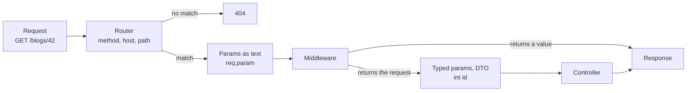

# Routing

A route connects a URL and an HTTP method to the code that answers it.

This is the path of one request through the router:



## Where routes live

Routes are in the `lib/routes` folder. Each file has one `Router` class.
The `prefix` of the router is added in front of all its routes.

```dart title="lib/routes/api.dart"
import 'package:dox_core/dox_core.dart';

class ApiRouter extends Router {
  @override
  String get prefix => 'api';

  @override
  List<dynamic> get middleware => <dynamic>[];

  @override
  void register() {
    Route.get('/ping', (DoxRequest req) => 'pong'); // GET /api/ping
  }
}
```

Dox finds every `Router` class by itself. It is in `lib/generated/container.g.dart` after `dart run build_runner build`.
To pick the order of routers, list them in `routers:` of `AppConfig`.
See [Dependency injection: routers and providers](dependency-injection.md#routers-and-providers).

The leading `/` in a path is optional. `'ping'` and `'/ping'` are the same route.

## Route methods

```dart
Route.get('/blogs', (BlogController c) => c.index);
Route.post('/blogs', (BlogController c) => c.store);
Route.put('/blogs/{id}', (BlogController c) => c.update);
Route.patch('/blogs/{id}', (BlogController c) => c.update);
Route.delete('/blogs/{id}', (BlogController c) => c.destroy);
```

!!! info
    There are also `Route.options`, `Route.copy`, `Route.view`, `Route.link`, `Route.unlink`,
    `Route.purge`, `Route.lock`, `Route.unlock` and `Route.propfind`.

    `Route.health('/health')` adds a health check route. It answers `200` with `{"status": "ok"}`.
    `Route.websocket('echo', (WebSocket socket, DoxRequest req) {...})` adds a raw WebSocket route.
    By default any website can open it from a browser, with the cookies of the user. To check the `Origin`, pass `allowedOrigins: ['https://app.example.com']`, or set `AppConfig(webSocketAllowedOrigins: [...])` for every WebSocket route. Then only pages of the same host and the listed sites can open it. Other origins get `403`. `[]` means the same host only.
    When a WebSocket route has no check, Dox prints one warning to stderr at start.
    A message over `maxMessageSize` bytes (default 16 MB) closes the socket with code `1009`. Example: `Route.websocket('chat', handler, maxMessageSize: 64 * 1024)`.

A `HEAD` request runs the `GET` route of the same path. The answer has the status and headers of `GET`, with no body.

## The handler

The second argument is the code that answers the request. It can be:

```dart
// a function
Route.get('/ping', (DoxRequest req) => 'pong');

// a controller method. The controller comes from the container.
Route.get('/ping', (WebController c) => c.pong);

@Inject()
class WebController {
  String pong(DoxRequest req) {
    return 'pong';
  }
}

// a list: middleware first, the controller last
Route.get('/ping', <dynamic>[
  LoggerMiddleware(),
  (WebController c) => c.pong,
]);
```

In a list, the last item is the controller. The items before it are [middleware](middleware.md).
`(WebController c) => c.pong` picks the method. Dox calls it once per isolate, at start.
See [Dependency injection](dependency-injection.md).

See [Controller](controller.md) for the parameters a handler can ask for.

## Route params

Put a param in `{}`. Ask for it as a typed parameter in the controller.

```dart
Route.get('/blogs/{id}', (BlogController c) => c.show);

@Inject()
class BlogController {
  Future<Blog?> show(int id) async {
    return Blog().find(id);
  }
}
```

`/blogs/abc` answers `404`, because `abc` is not an `int`.
See [Controller: parameters](controller.md#parameters) for all the rules.

### Optional param

`{name?}` can be missing. Use a nullable type.

```dart
Route.get('/posts/{page?}', (int? page) {
  return 'page ${page ?? 1}'; // GET /posts and GET /posts/2 both match
});
```

### Catch-all param

`{name*}` matches the rest of the path, with slashes.

```dart
Route.get('/docs/{page*}', (String page) {
  return page; // GET /docs/a/b/c gives 'a/b/c'
});
```

## Group routes

```dart
// by prefix
Route.group('/blogs', () { // (1)!
  Route.get('/', (BlogController c) => c.index); // GET /blogs
  Route.get('/{id}', (BlogController c) => c.show); // (2)!
});

// by domain
Route.domain('dartondox.com', () { // (3)!
  Route.get('/ping', (WebController c) => c.pong);
});

// by middleware
Route.middleware(<dynamic>[AuthMiddleware()], () { // (4)!
  Route.get('/me', (AuthController c) => c.me);
  Route.post('/logout', (AuthController c) => c.logout);
});
```

1.  `/blogs` goes in front of every path in the callback.
    Dox puts one `/` between the parts. `'blogs'` and `'/blogs/'` work the same.
2.  Makes `GET /blogs/{id}`.
3.  These routes match only when the `Host` header is `dartondox.com`. Other hosts get `404`.
4.  `AuthMiddleware` runs before `me` and `logout`. It runs after the global and router middleware.

Groups can be nested. `Route.group('blogs', ...)` with `Route.get('all', ...)` makes `/blogs/all`.

A group can also add a prefix to the [route names](#named-routes) inside it, with `name:`.

To turn CORS on or off for some routes, see [CORS](../security/cors.md).

## Resource routes

One line makes the usual CRUD routes for a controller.

```dart
Route.resource('blogs', BlogController);
```

`BlogController` is a class from the container. A controller object works too: `Route.resource('blogs', BlogController())`.

| Method | Path | Controller method | Route name |
| --- | --- | --- | --- |
| `GET` | `/blogs` | `index` | `blogs.index` |
| `GET` | `/blogs/create` | `create` | `blogs.create` |
| `POST` | `/blogs` | `store` | `blogs.store` |
| `GET` | `/blogs/{id}` | `show` | `blogs.show` |
| `GET` | `/blogs/{id}/edit` | `edit` | `blogs.edit` |
| `PUT`, `PATCH` | `/blogs/{id}` | `update` | `blogs.update` |
| `DELETE` | `/blogs/{id}` | `destroy` | `blogs.destroy` |

The name comes from the path: `/` becomes `.`, and `{params}` are left out.
So `Route.resource('users/{user}/posts', ...)` gives `users.posts.index`.
Pass `name:` to pick another one: `Route.resource('blogs', BlogController, name: 'posts')`.

A method that the controller does not have is skipped. No route is made for it.
Any other error from the controller is not hidden. It stops the app at start, so you see it.
See [Resource controller](controller.md#resource-controller) to make one with the CLI.

## Forms with PUT, PATCH and DELETE

An HTML form can only send GET or POST. To reach a `PUT`, `PATCH` or `DELETE` route, add `MethodOverride` to the global middleware.

```dart
AppConfig(
  globalMiddleware: <dynamic>[const MethodOverride()],
);
```

Then send the form as POST with a `_method` field.

```html
<form method="POST" action="/blogs/5">
  <input type="hidden" name="_method" value="DELETE">
</form>
```

- Only a POST request changes, and only to `PUT`, `PATCH` or `DELETE`. Other values are ignored.
- `req.method` gives the new method.
- `CsrfMiddleware` still checks the request, so send the `_token` field too.
- It works only in `globalMiddleware`, not on a router or a route. It is off by default.

## Named routes

Give a route a name with `.name()`. Then build its URL from the name, so a path lives in one place.

```dart
Route.get('/users/{id}', (UserController c) => c.show).name('users.show');

route('users.show', params: <String, Object>{'id': 5});
// /users/5

route('users.show', params: <String, Object>{'id': 5}, query: <String, Object>{'tab': 'posts'});
// /users/5?tab=posts
```

`route()` gives the path. `Route.url()` does the same.
Param values are URL encoded. A missing `{name?}` param is left out.

A group can put a prefix in front of the names inside it:

```dart
Route.group('admin', () {
  Route.get('users', (UserController c) => c.index).name('users'); // admin.users
}, name: 'admin.');
```

Dox stops with a clear error when:

- two routes have the same name (at start),
- `route()` gets a name that no route has,
- a `{param}` of the path has no value, or `params` has a key the path does not have.

### Signed routes

A signed URL is a named route with a `signature` in its query, so nobody can change it. Use it for links in emails, like "unsubscribe".
Protect the route with `ValidateSignature`, and make the URL with `Route.signedUrl`:

```dart
Route.get('/unsubscribe/{user}', <dynamic>[
  const ValidateSignature(),
  (UserController c) => c.unsubscribe,
]).name('unsubscribe');

Route.signedUrl('unsubscribe',
    params: <String, Object>{'user': 5}, expires: Duration(days: 7));
// https://example.com/unsubscribe/5?expires=...&signature=...
```

A changed or expired URL gets `403`. See [Signed URLs](../security/signed-urls.md).

## Route model binding

A binder turns a route param into a value before the controller runs, for example a model from the database.
Add it with `Route.bind`, before the routes that use it.

```dart
Route.bind<User>('user', (String id) => User().find(id));

Route.get('/users/{user}', (DoxRequest req, User user) {
  return user;
});
```

Every route with a `{user}` param now runs the binder first.
The binder gets the raw text from the URL. It returns the value, or `null` when there is none.
`null` answers `404`, the same way as a thrown `NotFoundHttpException`.

There are two ways to read the value:

- Ask for a parameter of the bound type, like `User user`. Dox matches it by type, so it can be at any place in the parameter list.
- Read it from the request: `req.bound<User>('user')`. This also works in a controller that only takes `DoxRequest`.

Other path params still work next to it:

```dart
Route.get('/users/{user}/posts/{page}', (User user, int page) {
  return user.posts(page);
});
```

The binder runs after the middleware, so an auth middleware can stop the request before any database call.

A `@DoxModel` class does not need `Route.bind`. Dox makes a binder for it in `lib/generated/container.g.dart`.
See [Dependency injection: route model binding](dependency-injection.md#route-model-binding).
`Route.bind` wins when both exist.

## Serve static files

`Route.staticFiles(prefix, folder)` serves the files of a folder, like CSS, JavaScript and images.

```dart
Route.staticFiles('/', 'public');
Route.staticFiles('build', 'public/build', maxAge: Duration(days: 365));
```

- Only `GET` and `HEAD` requests read files, and only when no route matches. A route always wins.
- `..`, dot files (like `.env` or `.git`) and folders are never sent. They get `404`.
- The one dot folder that is sent is `.well-known` at the top of the folder (`public/.well-known/...`). It holds ACME (Let's Encrypt) challenges, `security.txt` and `apple-app-site-association`. Dot files inside it still get `404`.
- A file gets a weak `ETag` (from its size and change time) and `Last-Modified`. The browser gets `304` with no body when it already has the file. `If-None-Match` wins over `If-Modified-Since`. Range requests work. With `If-Range`, the Range is used only when it is the file's `Last-Modified` date. Else the whole file is sent.
- `maxAge` sends `Cache-Control: public, max-age=...`. Give a long `maxAge` to build files with a hash in the name (like Vite's).
- No middleware runs for a file. The global CORS config still applies.
- Like other routes, the prefix follows `Route.group`, the router prefix and `Route.domain`.
- The folder path is relative to the folder the app starts in. Symlinks in the folder are followed.

!!! warning
    Never save user uploads in this folder. An uploaded html or svg file would run its script on your site.
    Use [`dox_storage`](../packages/storage.md) for uploads. It sends such files as downloads.

Behind a proxy, the proxy can serve the folder instead. Then the files never reach Dox.

## Serve storage files

`Storage.route(path)` from the [`dox_storage`](../packages/storage.md) package serves the files of a storage disk at `GET <path>/{key*}`.
By default only signed URLs work. Other requests get `403`.
See [File Storage](../digging-deeper/file-storage.md#serve-local-signed-urls).

```dart
Storage.route('files');
Storage.route('public', disk: 'local', signed: false);
```

An html, svg, xml or javascript file is sent as a download (`Content-Disposition: attachment`) with `Content-Security-Policy: sandbox`.
So a script in an uploaded file does not run on your site.
Every file response also has `X-Content-Type-Options: nosniff`, so the browser does not guess another type.

For user uploads, `download: true` sends every file as a download, also images and PDFs:

```dart
Storage.route('uploads', download: true);
```

## Request body for the docs

`post`, `put` and `patch` take a `body:` schema. It shows in the [OpenAPI docs](../packages/openapi.md).
It does **not** check the request. To check input, use a [DTO](validation.md).

```dart
Route.post('/posts', (PostController c) => c.store, body: v.object(<String, Schema<Object?>>{
  'title': v.string().min(3),
}));
```

## Mount a raw handler

`Route.mount(prefix, handler)` sends every request under a path prefix straight to a raw `HttpRequest` handler.
It runs before routing and before the body is read. The handler writes and closes the response itself.
[Socket.IO](../packages/socketio.md) uses it for `/socket.io/`.

```dart
Route.mount('/socket.io/', io.handle);
Route.mount('/admin', admin.handle, middleware: true);
```

How the prefix matches:

- It matches whole path parts. `/admin` matches `/admin`, `/admin/` and `/admin/users`. It never matches `/administrator` or `/admin-login`.
- A trailing `/` does not change the match. `/socket.io/` also matches `/socket.io`.
- The query string is not part of the match.
- When two prefixes match, the longest one wins. `//` counts as one `/`, so `/admin//secure/x` goes to a mount at `/admin/secure`.
- The match uses the raw path. `%2F` stays encoded, so `/admin/secure%2Fx` goes to a mount at `/admin`. To protect a nested path, set `middleware: true` on the outer mount too.

!!! warning
    By default a mount skips all middleware, also the global middleware (security headers, CSRF, rate limit).
    Set `middleware: true` to run `AppConfig.globalMiddleware` before the handler.
    The global CORS config never applies to a mount. The handler must send its own CORS headers.

With `middleware: true`:

- A middleware that gives a response (like `403`) stops the request. The handler does not run.
- The body is not read for the middleware, so the handler can still read it. A CSRF token must come in a header.
- The handler sends the answer itself. So the part of a `next` middleware that runs after the handler cannot change the answer.
- A `terminate` step runs once the answer is sent, like on other routes.
- `RequestTimeout` does not run for a mount. The handler already owns the answer.
- Cookies that a middleware adds after the handler (the session cookie, `XSRF-TOKEN`) are not sent. Get the CSRF token from a normal route.
- An error in the handler gives `500`, like without middleware.
